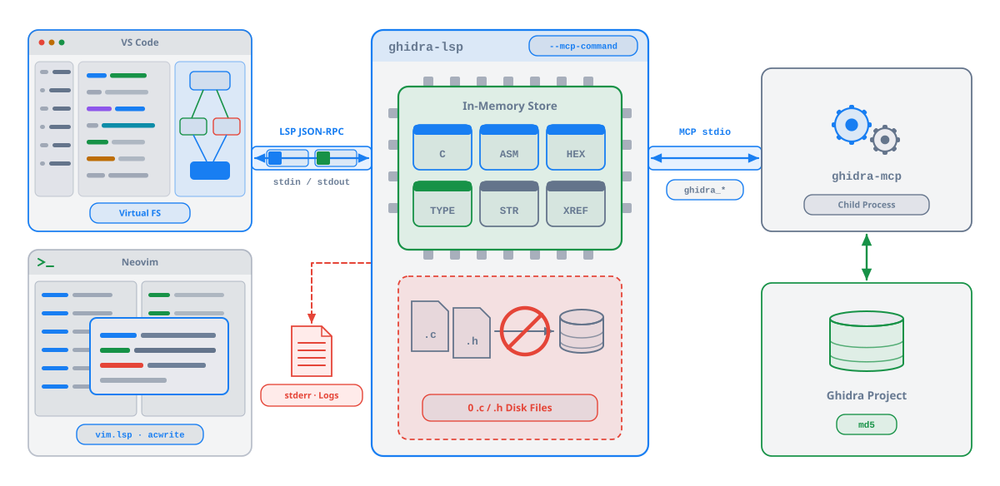

# ghidra-lsp


[](docs/zh-CN/README.md)
[](docs/ja/README.md)

`ghidra-lsp` is a Language Server Protocol (LSP) server for live Ghidra decompilation and reverse engineering through `ghidra-mcp`.

It serves Ghidra decompiled pseudocode, disassembly listings, hexadecimal byte windows, control-flow graphs, call graphs, cross-references, comments, and data types in Visual Studio Code and Neovim without writing `.c` or `.h` files to disk.

## Key capabilities

- **Strict in-memory virtual documents**: Serves `ghidra://`, `ghidra-listing://`, `ghidra-memory://`, `ghidra-type://`, `ghidra-string://`, and `ghidra-reference://` views in memory with zero `.c` or `.h` files on disk.
- **Protocol isolation**: Reads LSP JSON-RPC requests from `stdin`, writes framed LSP JSON-RPC responses only to `stdout`, writes logs only to `stderr`, and runs `ghidra-mcp` as a child process over MCP `stdio`.
- **Single-decompile request budget**: Fetches GUI lines, decompiler tokens, native cursor bindings, and all five Ghidra comment kinds (`plate`, `pre`, `eol`, `post`, `repeatable`) in one `decompilation.get` call.
- **UTF-16 and checked `u64` safety**: Computes every LSP `Position` and `Range` in UTF-16 code units, slices UTF-8 strings only at character boundaries, and computes memory addresses with checked 64-bit math.
- **Controlled persistence**: Keeps decompiled C text read-only except for scoped `<F2>` rename previews that require saving the origin buffer, and guards mutations with optimistic conflict checks and write-timeout state verification.
- **Full editor integrations**: Provides custom editors, synchronized webviews, horizontal 5-kind comment badge tabs, and interactive call graphs in Visual Studio Code, and 26 `:Ghidra*` commands and virtual buffers in Neovim. Both editor integrations can install missing `ghidra-lsp` and `ghidra-mcp` binaries automatically through `npm`.

## Architecture overview



`ghidra-lsp` connects LSP clients to the `ghidra-mcp` backend (`ghidra_*` tools). It maintains canonical lowercase 32-hex `md5` session hashes, canonical `space:offset` addresses, symbol IDs, and raw mangled names in every URI and RPC payload while formatting `ram:` addresses as bare hex and optionally collapsing outer C++ template arguments for display.

## Visual tour

### Visual Studio Code workbench

In Visual Studio Code, `ghidra://` pseudocode opens beside synchronized **Control Flow**, **Listing**, **Memory and Bytes**, and **Call Graph** views, with inline five-kind comments and **Program Browser** trees.


### Neovim workbench

In Neovim, `:Ghidra*` commands open synchronized splits for disassembly listings, memory bytes with a live **Data Inspector**, control-flow graphs, call graphs, and a floating five-tab comment editor.


## Quick start

### 1. Install with npm

If you have Node.js 18 or later, npm can install the prebuilt executable for your platform:

```sh
npm install --global @ghidra-lsp/cli
ghidra-lsp --version
```

Or run directly with `npx`:

```sh
npx @ghidra-lsp/cli --version
```

npm installs one matching platform package (`@ghidra-lsp/darwin-arm64`, `@ghidra-lsp/darwin-x64`, `@ghidra-lsp/linux-arm64`, `@ghidra-lsp/linux-x64`, `@ghidra-lsp/win32-arm64`, or `@ghidra-lsp/win32-x64`).
Do not use `--omit=optional`, because the platform packages are optional dependencies.
The Linux packages require glibc. On musl systems, build from source.

### 2. Or build from source

Building requires Rust `1.88` or newer, `ghidra-mcp`, and a configured Ghidra installation.

```sh
cargo build --locked --release
```

Install or place `target/release/ghidra-lsp` and `ghidra-mcp` on `PATH`, or pass `--mcp-command <PATH>` to `ghidra-lsp`.

### 3. Run repository checks

```sh
cargo xtask ci
```

### 4. Configure an editor

- **Visual Studio Code**: See the [VS Code extension README](editors/vscode/README.md) and the [VS Code Guide](docs/en/vscode-guide.md).
- **Neovim**: See the [Neovim plugin README](editors/nvim/README.md) and the [Neovim Guide](docs/en/neovim-guide.md).

## Documentation

Start with [Getting Started](docs/en/getting-started.md), or open a chapter directly:

| Chapter | Topics |
| --- | --- |
| [Getting Started](docs/en/getting-started.md) | Prerequisites, Rust build, CLI flags, verification steps, and troubleshooting |
| [Architecture](docs/en/architecture.md) | Process model, zero-disk-leak policy, 6 URI schemes, alignment, and single-decompile budget |
| [VS Code Guide](docs/en/vscode-guide.md) | Installation, sidebar views, custom editors, all `ghidraLsp.*` settings, and commands |
| [Neovim Guide](docs/en/neovim-guide.md) | Plugin setup, all 26 `:Ghidra*` commands, keymaps, comment float, and windows |
| [Editing and Safety](docs/en/editing-and-safety.md) | Scoped `<F2>` renames, 5 comment kinds, prototypes, JSONC `.ghidra-type` schema, and timeouts |
| [LSP and Development](docs/en/lsp-and-development.md) | LSP capability matrix, all 45 `workspace/executeCommand` APIs, layout, and `cargo xtask ci` |

## Workspace layout

- `src/`: Rust `ghidra-lsp` binary crate (`src/main.rs` entry point).
- `xtask/`: Repository hygiene checks, license collection, npm packaging, and CI runner (`cargo xtask ci`).
- `npm/cli/`: `@ghidra-lsp/cli` npm launcher package and version template.
- `editors/vscode/`: Visual Studio Code extension (`package.json`, TypeScript sources, JSON schema, TextMate grammars).
- `editors/nvim/`: Neovim client plugin (`plugin/ghidra-lsp.lua` and `lua/ghidra-lsp/`).
- `docs/`: Trilingual documentation (`en`, `zh-CN`, `ja`) and SVG assets.

## Releases and publishing

The [CI workflow](.github/workflows/ci.yml) uses `release-please` to keep `Cargo.toml`, `xtask/Cargo.toml`, `npm/cli/package.json`, `editors/vscode/package.json`, and `editors/vscode/package-lock.json` synchronized. It builds release executables for six targets (`darwin-arm64`, `darwin-x64`, `linux-arm64`, `linux-x64`, `win32-arm64`, `win32-x64`), packages the VS Code `.vsix` extension, and attaches those artifacts and license notices to the GitHub Release. It then publishes the six platform packages and `@ghidra-lsp/cli` to npm, publishes the VS Code extension to Visual Studio Marketplace with GitHub OIDC trusted publishing, and publishes to Open VSX when `OVSX_PAT` is set.
Each of the seven `@ghidra-lsp/*` npm packages and the Visual Studio Marketplace publisher `byteland-app` must have a trusted publisher configured for `ByteLandTechnology/ghidra-lsp` and `ci.yml`.

## License

Copyright 2026 ByteLand Technology Limited. Licensed under the [MIT License](LICENSE).
