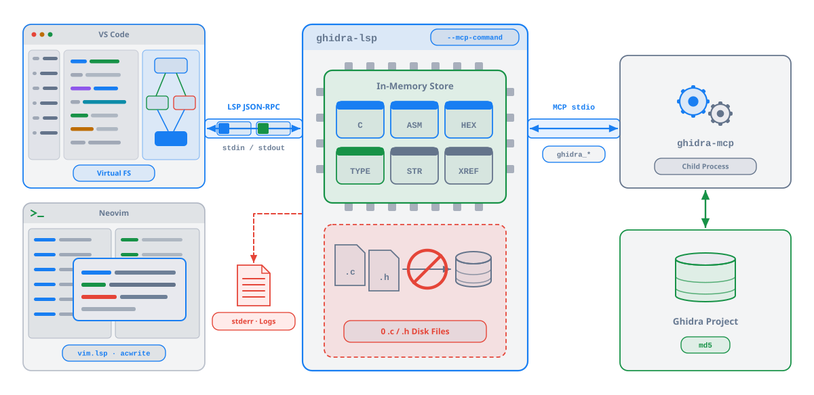
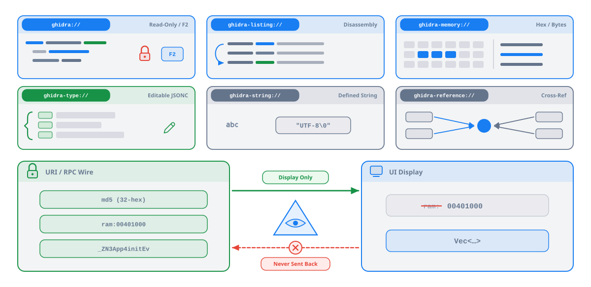
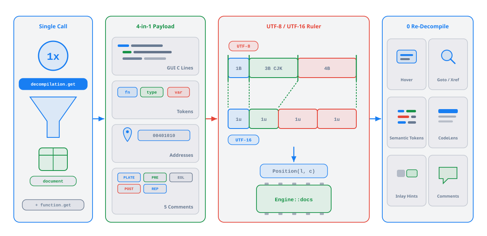

# Architecture

`ghidra-lsp` bridges Language Server Protocol (LSP) clients and `ghidra-mcp` without writing generated C or header files to disk. Every buffer, coordinate mapping, address operation, and backend transaction follows strict protocol and safety invariants.

## Process and transport model

- **LSP transport (`stdin` and `stdout`)**: `src/main.rs` connects `tower_lsp_server::LspService` and `LspServer` exclusively to `tokio::io::stdin()` and `tokio::io::stdout()`. Framed LSP JSON-RPC payloads never share `stdout` with diagnostic output.
- **Diagnostic logging (`stderr`)**: Server logs and inherited `ghidra-mcp` child logs (`Stdio::inherit()`) write only to `stderr`.
- **MCP child process (`src/backend.rs`)**: `McpBackend` lazily spawns `ghidra-mcp` with `TokioChildProcess` and `kill_on_drop(true)`. Every tool call targets `ghidra_<domain>` with `{"operation": "<op>", "params": {...}, "md5": "..."}`.
- **Zero-disk-leak policy**: Pseudocode, disassembly listings, memory windows, strings, reference previews, and JSONC data types stay in memory only across virtual URI providers. Zero `.c` or `.h` files are written to disk.

## Six virtual URI schemes

`ghidra-lsp` and its editor clients separate analysis surfaces into six dedicated virtual URI schemes:

| Scheme | Role | Representative URI shape | Writable |
| --- | --- | --- | --- |
| `ghidra://` | Server-managed decompiled C functions and markdown/text snapshots | `ghidra://<md5>/function/<encoded-entry>`, `/symbol/<id>`, `/references/<id>`, `/type/<path>.md` | Read-only except scoped `<F2>` rename preview |
| `ghidra-listing://` | Windowed disassembly listing (also hosts Analysis & Control Flow tabs in VS Code) | `ghidra-listing://<md5>/listing/<addr>.ghidra-listing` (VS Code), `ghidra-listing://<md5>/<addr>` (Neovim) | Read-only |
| `ghidra-memory://` | Bounded hexadecimal byte windows with live Data Inspector | `ghidra-memory://<md5>/memory/<addr>.ghidra-bytes` (VS Code), `ghidra-memory://<md5>/<addr>` (Neovim) | Read-only |
| `ghidra-type://` | Structured JSONC data-type editor documents (`struct`, `union`, `enum`, `function`) | `ghidra-type://<md5><path>.ghidra-type?v=3` | Editable (except read-only kinds) |
| `ghidra-string://` | Decoded defined strings with reference CodeLens and lookup | `ghidra-string://<md5>/string/<addr>?{"address":...}` | Read-only |
| `ghidra-reference://` | Human-readable cross-reference peek wrappers over `ghidra://` or `ghidra-listing://` | `ghidra-reference://<md5>/<identity>/<label>?{"source":...}` | Read-only |

VS Code uses Ghidra-specific suffixes (`.ghidra-listing`, `.ghidra-bytes`, `.ghidra-type`) defined in `editors/vscode/src/virtual-files.ts` so "Set Default Editor" associations stay scoped to Ghidra tabs instead of binding `*.h` or `*`.

## Canonical identity versus display formatting

`ghidra-lsp` keeps machine identities unchanged in every URI and MCP/LSP RPC payload:

- **Program `md5`**: Normalized to 32 lowercase ASCII hexadecimal characters (`scoped_md5` validation).
- **Canonical address**: Preserved as `space:offset` (for example `ram:00401000` or `EXTERNAL:00000010`).
- **Symbol ID and raw mangled name**: Kept unchanged for `symbol.get`, `rename`, and hover metadata.

Presentation formatting applies only to human-facing labels:

- **Bare `ram:` hex display (`src/address.rs`)**: `display_address` strips a leading `ram:` prefix when all remaining characters are hexadecimal digits, keeping non-`ram` spaces explicit.
- **Outer C++ template folding (`src/document.rs`)**: When `templateArguments` is `"omit"` (default), `brief_templates` replaces outer `<...>` type parameter lists on identifiers with `<…>` while leaving C++ operators (`operator<<`, `operator->`, `operator<=>`) and synthetic `<EXTERNAL>` namespaces intact. Full demangled and raw mangled names remain visible in hover cards and tooltips.

## UTF-8, UTF-16 alignment, and checked `u64` math

### UTF-8 and UTF-16 coordinate mapping (`src/document.rs`, `src/workbench.rs`)

- During `initialize`, `ghidra-lsp` negotiates `PositionEncodingKind::UTF16`.
- Every `Document` stores UTF-8 byte offsets `[start, end)` on its `Span` entries.
- `position()` aligns byte indices to UTF-8 character boundaries (`text.is_char_boundary`) and counts line numbers and UTF-16 code units (`encode_utf16().count()`).
- `offset()` converts an incoming LSP UTF-16 `Position` back to a UTF-8 byte offset by summing `c.len_utf16()` along the target line.
- `workbench::semantic_tokens` splits multi-line spans at `\n` and encodes each single-line segment length in UTF-16 code units.

### Checked `u64` address arithmetic (`src/address.rs`)

- `parse_address` rejects non-memory spaces (`stack`, `register`, `const`, `unique`, `variable`, `hash`) and parses hexadecimal offsets with `u64::from_str_radix`.
- `add_address_offset` performs signed byte displacement in `i128` with `checked_add`, rejecting underflow below `0` or overflow above `u64::MAX`.
- `compare_addresses` sorts `ram` before other address spaces and compares numeric `u64` offsets in ascending order.

## Single-decompile request budget

To avoid redundant decompiler runs and out-of-sync line maps, `Engine::generate_inner` (`src/engine/mod.rs`) enforces a single-decompile budget:

1. **One `decompilation.get` request**: Sends `{"selector": {"entry": entry}, "scan": {"timeout_ms": 30000}, "format": "document", "include_comments": true}`.
2. **Unified payload extraction**: That single response carries the C text, GUI line layout (`lines`), decompiler tokens, native `CodeLocation` bindings (`address`, `code_unit_address`, `token_max_address`, `exact`), and supplemental `repeatable` comments together with inline `plate`, `pre`, `eol`, and `post` comments.
3. **Comment alignment (`src/comments.rs`)**: `comments::include` inserts supplemental repeatable comments into the buffer and shifts every following `Span` byte range before symbol resolution runs.
4. **Legacy fallback**: Only if an older `ghidra-mcp` rejects `"format": "document"` does the server fall back to `"format": "text"` plus `"format": "tokens"` and emit a warning diagnostic requesting a `ghidra-mcp` upgrade.
5. **Batched auxiliary reads**: Listing windows, CFGs, and call graphs batch multi-item reads through `ghidra_batch` (`batch.execute` with `transaction_mode: "per_item"`) or bounded `list_all` cursor pagination (`page.limit <= 1000`).

Next chapter: [VS Code Guide](vscode-guide.md) or [Neovim Guide](neovim-guide.md).
