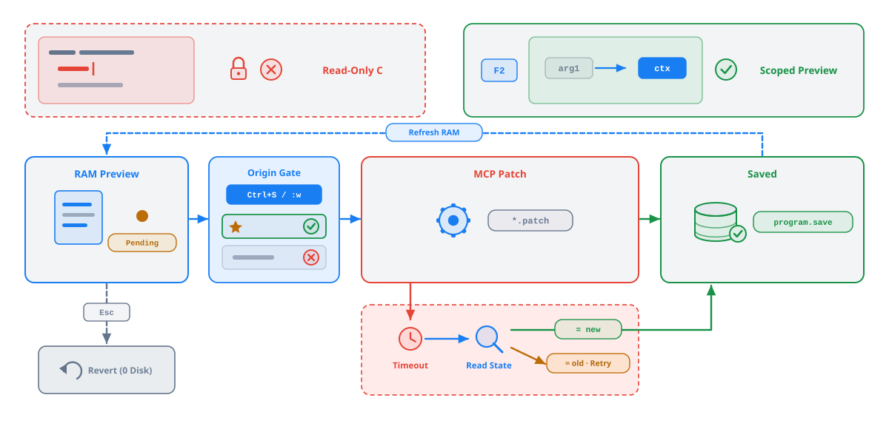
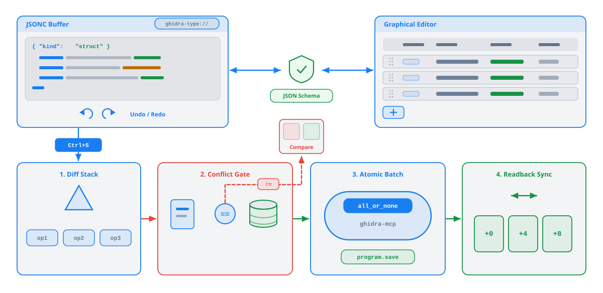

# Editing and Safety Guarantees

`ghidra-lsp` enforces strict safety checks around decompiled pseudocode, symbol renames, comments, function signatures, and JSONC data types so partial edits or network/process timeouts never corrupt a Ghidra project.

## Read-only C pseudocode guarantee

Decompiled C text under `ghidra://<md5>/function/<entry>` is generated from Ghidra analysis, not editable source code on disk. `Engine::save` and `ghidra.saveDocument` reject arbitrary text modifications (`"Only an F2 rename can be saved to Ghidra; arbitrary text edits are not supported"`).

Every change to a Ghidra program must run through a validated, scoped path:

1. Scoped `<F2>` symbol rename previews with origin-buffer save confirmation.
2. Five-kind comment mutations (`ghidra.saveComment`).
3. Function prototype and variable/parameter batch mutations (`ghidra.saveFunctionPrototype`, `ghidra.saveVariables`).
4. Validated JSONC `.ghidra-type` transactions (`ghidra.saveTypeDocument`).
5. Allowlisted workbench mutations (`ghidra.mutate`).

Before executing any mutation (`Server::ensure_program_clean`), the server blocks writes if the session holds a pending rename or unsaved local changes in any open virtual buffer.

## Scoped `<F2>` rename lifecycle and origin save

When you press `<F2>` (or run `ghidraLsp.renameSymbol` / `vim.lsp.buf.rename`) on a symbol inside a clean `ghidra://` buffer:

1. **Identifier and collision validation (`src/engine/rename.rs`)**: `valid_name` requires a non-empty ASCII C identifier (`[A-Za-z_][A-Za-z0-9_]*`). For `Local` and `Parameter` symbols, `Engine::rename` checks cached function parameters and locals and rejects duplicate names inside the function.
2. **Scoped preview planning**:
  - **Local variables and parameters**: Rewrites matching spans only inside the active `origin` document.
  - **Functions, globals, labels, and constants**: Rewrites matching spans across every open `ghidra://` document belonging to the same `md5` session.
  - In VS Code, `ReadonlyRenames` marks affected tabs with an `M` badge and shows a status bar item naming the pending rename.
3. **In-memory staging (`Pending`)**: No MCP write runs during `<F2>`. The server stores `{origin, symbol, new_name, expected, patched: false}` in memory.
4. **Origin-only commit**:
  - Saving a non-origin modified buffer validates the preview text locally without calling `ghidra-mcp`.
  - Saving the `origin` buffer (`Ctrl+S` in VS Code, `:w` in Neovim) verifies that every affected buffer matches either its original `base` or `expected` text, re-verifies live symbol identity (`id`, `address`, `namespace`, `kind`) against Ghidra, marks `patched = true`, sends the `patch` call, calls `program.save`, and regenerates all affected session documents.
5. **Cancellation**: Running **Ghidra: Discard Pending Rename** (`ghidra.discardRename` / `:GhidraDiscardRename`) reverts preview buffers back to `doc.base` and removes the pending plan.

## Five-kind comments, function signatures, and variables

### Five comment kinds (`src/mutations/mod.rs`)

`ghidra.commentsAt` and `ghidra.saveComment` manage all five Ghidra comment categories in fixed order. Both the VS Code horizontal **Comment type** badge strip (`ghidraLsp.selectCommentKind`) and the Neovim comment float footer display the five category tabs in this order:

| Kind | Tab badge label | Placement and behavior |
| --- | --- | --- |
| `plate` | `PLATE` | Block header comment above a function or code unit |
| `pre` | `PRE` | Comment displayed immediately before the target instruction or data unit |
| `eol` | `EOL` | End-of-line comment beside the statement or instruction |
| `post` | `POST` | Comment displayed immediately after the target instruction or data unit |
| `repeatable` | `REPEATABLE (ext)` | Supplemental repeatable comment inserted by `comments::include` during `decompilation.get` (when selected in VS Code, the active comment editor below shows author `REPEATABLE` and status `extension`) |

Before writing a comment, `prepare_comment_mutation` queries current comments at the target `CodeUnit` address and checks the client-supplied `expected` baseline. If the backend value changed concurrently, it fails with a conflict error instead of overwriting external work. Saving empty or whitespace-only text issues `comment.delete`; non-empty text issues `comment.upsert`, followed by `program.save` and session refresh.

### Function signatures and local variables (`src/mutations/prototype.rs`)

`ghidra.functionPrototype` captures the current function name, return type, calling convention, `hasVarArgs`, `hasNoReturn`, `isInline`, function comment, return storage, `hasCustomVariableStorage`, parameters (with structured `VariableStorageReference` values), locals, and an `original` snapshot.

When saving through `ghidra.saveFunctionPrototype` or `ghidra.saveVariables`, the server checks `original` against live Ghidra state and compiles changes into a single `batch.execute` request with `transaction_mode: "all_or_none"`:

- **Atomic prototype updates**: Function renames, calling conventions, flags, one-line C `signature` declarations (mutually exclusive with `return_type`, `calling_convention`, and `parameters`), and ordered `parameters` arrays (including pure parameter swaps and compatible custom `VariableStorageReference` preservation) execute in one atomic `function.patch` operation when supported by `ghidra-mcp`, or fall back automatically to an `all_or_none` `function.patch` plus `function_parameter.*` batch on older `ghidra-mcp` releases.
- **C type strings and header imports**: Data type fields, function parameters, global symbols, and local variables accept C type declarations directly (such as `const struct Packet *`, `int (*)[4]`, or `void (*)(int)`), converting pointer, array, and `(*)[N]` declarators to structured `DataTypeReference` AST objects automatically when connected to older `ghidra-mcp` releases, and multi-declaration C headers (`struct`, `union`, `enum`, `typedef`, and function definitions) import atomically in memory through `data_type.parse_c` (`:GhidraParseC` in Neovim or **Create Data Type -> Import C header** in VS Code).

## Write-timeout state-read recovery

`McpBackend::call` (`src/backend.rs`) classifies every MCP call using `is_read_only_operation`:

- **Read-only timeouts** (`get`, `list`, `read`, `wait`, `resolve`, `status`, `inspect`, `capabilities`, `describe`, `search` outside `batch`) drop the transport session and fail cleanly so retrying is safe.
- **Write and `batch` timeouts** drop the transport session and raise `"MCP <domain>.<operation> timed out; a write may have completed. Refresh before retrying."`

Recovery behavior across subsystems:

- **Pending renames (`Engine::save`)**: Sets `pending.patched = true` before dispatching `patch`. If a write times out, `patched` remains `true`. On the next origin save, `resolve_rename_target` reads the current symbol name from Ghidra first: if the new name is already live, it skips `patch` and proceeds directly to `program.save`; if the old name is still active, it clears `patched` and asks the user to save again.
- **Comments, prototypes, and data types**: When a write returns an uncertain result, the editor sets its state to `uncertain` (`InlineComments`, `EditingUI`, `DataTypeFiles`, and Neovim `edit.lua` / `buffer.lua`) and blocks blind resubmission until you close, refresh, or compare against current Ghidra state.

## JSONC `ghidra-type://` schema and transactions

Virtual `.ghidra-type` documents (`ghidra-type://<md5><path>.ghidra-type`) follow `editors/vscode/schemas/data-type.schema.json` and `src/types_doc/`. Documents intentionally omit `"$schema"` inside JSONC text because VS Code binds schema checks through `jsonValidation` in `package.json`, and the graphical **Data Type Editor** header provides a **JSONC** button to open the raw `.ghidra-type` text side by side.

### Editable type kinds and constraints

Every JSONC document requires top-level read-only `path` and `kind` fields plus the kind-specific body:

| `kind` | Required body | Schema bounds and rules |
| --- | --- | --- |
| `struct` | `fields` array | Each item requires `name`, `type`, and integer `offset` (`0..2147483647`), plus optional `id` and `length` (`1..2147483647`); duplicate offsets are rejected |
| `union` | `fields` array | Each item requires non-empty `name` and `type`, plus optional `id` and `length` (`1..2147483647`); `offset` is forbidden (`not: required: [offset]`) |
| `enum` | `values` array | Each item requires non-empty `name` and integer `value` inside IEEE-754 lossless range `-9007199254740991..9007199254740991`, plus optional `id` |
| `function` | `signature` object | Requires `return_type`, non-empty `calling_convention` (default `"default"`), boolean `has_var_args`, boolean `has_no_return`, and `parameters` array (`name`, `type`) |

### Read-only type conditions (`src/types_doc/model.rs`)

Built-in primitives, pointers, arrays, typedefs, enums containing 64-bit values outside `±9007199254740991`, function definitions lacking structured `signature`, layouts with bitfields (`:N` suffix) or zero-length/duplicate-offset fields, and layouts with anonymous members exceeding limits (`> 1` in structs, `> 0` in unions) open read-only with an explanatory comment header.

### Conflict checks and save readback

1. **Live validation**: `ghidra.validateTypeDocument` parses JSONC, forbids duplicate object keys, checks schema constraints and type syntax (`parse_type_ref`), and returns exact UTF-16 `Range` diagnostics.
2. **Optimistic conflict detection**: On save, `ghidra.saveTypeDocument` queries `data_type.get` again and compares it structurally (`same_type_data`) against the opened `original` snapshot. On mismatch, it rejects the write, preserves your draft, and lets you inspect differences with **Compare Data Type with Ghidra**.
3. **Atomic write and readback**: Applies `data_type.patch` or `data_type.upsert` (gated by `workbench::allow_write`), saves with `program.save`, refreshes open function decompilations, and reads back the normalized type text (actual Ghidra field offsets and updated member `id` values) and the refreshed `original` snapshot.

Next chapter: [LSP and Development Guide](lsp-and-development.md).
