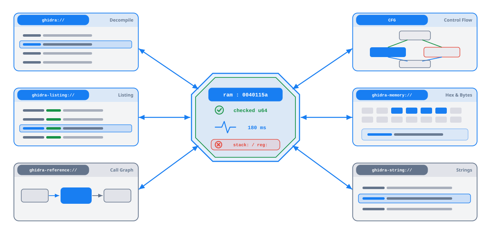

# Neovim Guide

The Neovim plugin in `editors/nvim/` integrates `ghidra-lsp` with native Neovim `vim.lsp` features, searchable floating pickers, a 5-kind comment float, structured signature/type editors, and virtual reverse-engineering splits.


## Requirements and installation

- Neovim `>= 0.10` (verified by `:checkhealth ghidra-lsp`)
- Node.js and `npm` on `PATH` for automatic binary installation (`auto_install = true`, default), or pre-installed `ghidra-lsp` and `ghidra-mcp` executables

Missing default binaries install automatically via `npm` (`@ghidra-lsp/cli` and `@ghidra-mcp/cli`) into the shared managed bin directory (`~/.local/share/ghidra-lsp/bin` on Linux and macOS, or `%LOCALAPPDATA%\ghidra-lsp\bin` on Windows), which is shared with the VS Code extension. Run `:GhidraInstall` at any time to install or update them.

### `lazy.nvim`

```lua
{
  'ghidra-lsp',
  dir = '/path/to/ghidra-lsp/editors/nvim',
  config = function()
    require('ghidra-lsp').setup({
      server_path = 'ghidra-lsp',
      mcp_command = 'ghidra-mcp',
      mcp_args = {},
      request_timeout_ms = 35000,
      template_arguments = 'omit',
      auto_attach = true,
    })
  end,
}
```

### `packer.nvim`

```lua
use({
  '/path/to/ghidra-lsp/editors/nvim',
  config = function()
    require('ghidra-lsp').setup({
      server_path = 'ghidra-lsp',
      mcp_command = 'ghidra-mcp',
      mcp_args = {},
      request_timeout_ms = 35000,
      template_arguments = 'omit',
      auto_attach = true,
    })
  end,
})
```

### `vim.pack` (Neovim 0.12+)

Because the Neovim plugin lives in the `editors/nvim` subdirectory of the repository, register the repository with `vim.pack.add` or add `editors/nvim` directly to `runtimepath` before calling `setup`:

```lua
vim.pack.add({
  'https://github.com/ByteLandTechnology/ghidra-lsp',
})
vim.opt.runtimepath:append(vim.fn.stdpath('data') .. '/site/pack/core/opt/ghidra-lsp/editors/nvim')
require('ghidra-lsp').setup({
  server_path = 'ghidra-lsp',
  mcp_command = 'ghidra-mcp',
  template_arguments = 'omit',
})
```

### Configuration options (`setup(opts)`)

| Option | Default | Description |
| --- | --- | --- |
| `server_path` | `'ghidra-lsp'` | Executable name or path for `ghidra-lsp` |
| `mcp_command` | `nil` | Executable override passed with `--mcp-command` when non-empty |
| `mcp_args` | `{}` | List of extra CLI flags passed as repeated `--mcp-arg` options |
| `request_timeout_ms` | `35000` | Passed through `--request-timeout-ms` and `initializationOptions.requestTimeoutMs` |
| `template_arguments` | `'omit'` | `'omit'` shows outer C++ template lists as `<…>`; `'show'` expands them |
| `auto_attach` | `true` | Automatically attach the LSP client to `ghidra://` buffers |
| `auto_start` | `false` | When `true`, starts the `ghidra-lsp` client immediately inside `setup()` |
| `auto_install` | `true` | When `true`, automatically installs missing default `ghidra-lsp` and `ghidra-mcp` binaries via `npm` into the shared managed bin directory |

Run `:checkhealth ghidra-lsp` at any time to inspect the Neovim version, `npm` availability, shared managed bin directory, `ghidra-lsp` and `ghidra-mcp` resolution paths and sources (`managed`, `path`, or `custom`), running LSP client ID and `utf-16` offset encoding, active session MD5, and any active pending rename.

## Complete `:Ghidra*` command reference

`editors/nvim/plugin/ghidra-lsp.lua` registers all 25 user commands:

| Command | Arguments | Action |
| --- | --- | --- |
| `:GhidraInstall` | `[lsp\|mcp]` | Install or update managed `ghidra-lsp` and `ghidra-mcp` binaries via `npm` |
| `:GhidraOpenBinary` | `[path]` | Open a binary (file completion); restores silently if analyzed, or prompts to analyze |
| `:GhidraSelectSession` | `[md5]` | Pick or activate an open or saved Ghidra session |
| `:GhidraCloseSession` | `[md5]` | Close the active or specified clean session |
| `:GhidraReanalyze` | — | Run or re-run auto-analysis on the active program |
| `:GhidraOpenFunction` | `[entry\|name]` | Open a function by entry/name (supports `<Tab>` completion) or from the picker |
| `:GhidraFunctions` | — | Open the searchable floating picker for program functions |
| `:GhidraSymbols` | — | Browse and jump to program symbols |
| `:GhidraTypes` | — | Browse Ghidra data types |
| `:GhidraStrings` | — | Browse defined strings and open `ghidra-string://` buffers |
| `:GhidraGoto` | `[address]` | Jump to address in decompilation, or fall back to Program Listing |
| `:GhidraListing` | `[address]` | Open `ghidra-listing://` disassembly split at cursor or address |
| `:GhidraMemory` | `[address]` | Open `ghidra-memory://` hex and Data Inspector split |
| `:GhidraHex` | `[address]` | Alias for `:GhidraMemory` |
| `:GhidraComment` | `[address]` | Open the 5-kind floating comment editor at cursor or address |
| `:GhidraEditFunction` | — | Open floating YAML-style form to edit signature, calling convention, flags, and parameters |
| `:GhidraEditVariables` | — | Pick and rename/retype a parameter or local variable |
| `:GhidraControlFlow` | — | Open `ghidra-cfg://` basic-block control-flow graph for the current function |
| `:GhidraCallGraph` | `[entry\|address]` | Open `ghidra-callgraph://` bounded caller/callee neighborhood view |
| `:GhidraEditType` | `[path]` | Open editable `ghidra-type://<md5><path>.ghidra-type` JSONC buffer |
| `:GhidraRefresh` | — | Refresh the active virtual buffer (`ghidra://`, `ghidra-listing://`, `ghidra-memory://`, `ghidra-cfg://`, `ghidra-callgraph://`, or `ghidra-type://`) |
| `:GhidraDiscardRename` | — | Cancel pending `<F2>` scoped rename preview and revert clean buffers |
| `:GhidraOrigin` | — | Jump back to the origin buffer of an active pending rename |
| `:GhidraOverview` | — | Open `ghidra-overview://` program overview snapshot |
| `:GhidraCallHierarchy` | — | Inspect incoming and outgoing LSP call hierarchy at cursor |

## Keymaps in `ghidra://` buffers

Installed on every `ghidra://` buffer by `buffer.lua`:

| Keymap | Scope | Action |
| --- | --- | --- |
| `<F2>`, `<leader>rn` | All `ghidra://` buffers | Preview scoped symbol rename (`:w` on origin commits; `:GhidraDiscardRename` cancels) |
| `<leader>ca` | All `ghidra://` buffers | Open LSP Code Actions menu |
| `K` | All `ghidra://` buffers | Show rounded hover popup |
| `<C-k>` | All `ghidra://` buffers | Show rounded signature help popup |
| `gd` / `gD` / `gi` | All `ghidra://` buffers | Go to Definition / Declaration / Implementation |
| `gy` / `gr` / `gO` | All `ghidra://` buffers | Go to Type Definition / Find References / Document Symbols |
| `<leader>gl` | Function buffers | Open Program Listing (`ghidra-listing://`) at cursor |
| `<leader>gm` | Function buffers | Open Hex and Memory Viewer (`ghidra-memory://`) at cursor |
| `<leader>gc` | Function buffers | Open 5-kind comment float at cursor |
| `<leader>gt` | All `ghidra://` buffers | Open `.ghidra-type` JSONC editor for type at cursor or from the picker |
| `<leader>go` | Function buffers | Go to address (`:GhidraGoto`) |
| `<leader>gh` | Function buffers | Show LSP call hierarchy (`:GhidraCallHierarchy`) |
| `q` | Snapshot buffers | Close split window when multiple windows exist |

## Theme-linked floating UI and highlights (`ui.lua`, `init.lua`)

During `setup()`, `ui.setup_highlights()` defines seven `default = true` highlight groups linked to your active colorscheme and re-applies them automatically on `ColorScheme` events through the `GhidraLspHighlights` augroup:

| Highlight group | Default link | Role |
| --- | --- | --- |
| `GhidraFloatBorder` | `FloatBorder` | Floating window borders (`comment`, `edit_function`, `pick`) |
| `GhidraFloatTitle` | `Title` | Floating window title bar text |
| `GhidraFloatFooter` | `Comment` | Footer hints and empty inactive comment tabs |
| `GhidraTabActive` | `PmenuSel` | Active comment-kind badge in title and footer |
| `GhidraTabDirty` | `DiagnosticWarn` | Unsaved `*` indicator, conflict notes, and zero-match count |
| `GhidraTabFilled` | `DiagnosticInfo` | Populated inactive comment tabs and saved status badges |
| `GhidraStatusAccent` | `Special` | Border separators (` │ `), picker match counts, and key hints |

The searchable floating picker (`M.pick`) also uses `FLOAT_WINHIGHLIGHT`, a chunk-highlighted border title showing `(shown/total)` match counts, and a Neovim 0.10+ footer hint (`<CR> select · <C-n>/<C-p> move · <Esc>/q close`).

## Five-kind comment float (`ghidra-comment://`)

Running `<leader>gc`, `:GhidraComment [address]`, or choosing the comment Code Action opens a centered floating Markdown buffer (`edit.lua`) anchored to the resolved `CodeUnit` address with `FLOAT_WINHIGHLIGHT`.

- The top border highlights `Ghidra Comments · <address>` (`GhidraFloatTitle`), the active kind badge `[PRE]` or `[PRE*]` (`GhidraTabActive` / `GhidraTabDirty`), and save notes (`saved`, external conflict, or uncertain outcome).
- The bottom border displays all five Ghidra comment categories in fixed order (`[PLATE]`, `[PRE]`, `[EOL]`, `[POST]`, `[REPEATABLE (ext)]`) with distinct active (`GhidraTabActive`), dirty `*` (`GhidraTabDirty`), populated (`GhidraTabFilled`), and empty (`GhidraFloatFooter`) highlights, followed by ` │ :w/<C-s> save · <Tab> kind · q close` (adapting compactly on narrow windows).
- **Edit**: Edit text directly in the float for the active tab, and press `<Tab>` or `<S-Tab>` to switch among the five comment kinds while keeping unsaved per-kind drafts intact. Native `d` is never mapped in normal mode so Vim operators (`dd`, `dw`, `d$`) work normally.
- **Save**: Run `:w` or press `<C-s>` to commit the active tab to Ghidra through `ghidra.saveComment` with optimistic `expected` conflict verification.
- **Delete**: Clear the text inside the active comment tab (empty or whitespace-only, for example `:%d`) and save with `:w` or `<C-s>`. The server issues a `comment.delete` operation and persists the project.
- **Close**: Press `q` or `<Esc>` to close the float (prompts to keep or discard when any tab has unsaved drafts).

## Reverse-engineering windows and view sync



| Buffer scheme | Features and buffer-local keymaps |
| --- | --- |
| `ghidra-listing://` | Memory block banner, collapsed undefined runs, function headers, inline comments, xrefs. Keys: `<CR>` / `d` decompile at address, `m` open Memory, `c` open comment float, `gr` / `x` incoming xrefs into Quickfix, `g` go to address, `]p` / `[p` page forward/back, `]b` / `[b` next/previous memory block, `r` refresh, `q` close. |
| `ghidra-memory://` | 16-byte hex + ASCII rows with live 2-line Data Inspector (`uint8`, `int8`, `char`, `utf8`, `uint16`, `uint32`, `int32`, `uint64`, `ptr`) decoded from `ghidra.inspectBytes` on `CursorMoved`. Keys: `<CR>` / `l` open Listing, `d` decompile, `e` toggle endianness (`little`/`big`), `]p` / `[p` next/previous chunk, `g` go to address, `r` refresh, `q` close. |
| `ghidra-cfg://` | Ordered basic blocks with instructions and outgoing branch edge arrows. Keys: `<CR>` reveal block in decompiler, `l` open Listing, `r` refresh, `q` close. |
| `ghidra-callgraph://` | Incoming callers, root function, outgoing callees, and call-site edges. Keys: `<CR>` open function, `l` open Listing, `+` / `-` adjust depth (`1..3`), `r` refresh, `q` close. |
| `ghidra-string://` | Read-only decoded string content. Keys: `gr` / `x` incoming xrefs in Quickfix, `<leader>gl` open Listing, `<leader>gm` open Memory, `q` close. |
| `ghidra-type://` | Editable `.ghidra-type` JSONC buffer with live validation diagnostics on `TextChanged` and `InsertLeave`, conflict detection, and normalized text readback on `:w` (built-in types and unsupported layouts open read-only). |

Function signature and local variable forms (`:GhidraEditFunction` and `:GhidraEditVariables`) commit edits atomically through `ghidra.saveFunctionPrototype` and `ghidra.saveVariables`; the `:GhidraEditFunction` float (`ghidra-edit-fn://`) uses chunk-highlighted title (`Edit Function · <name> [<addr>] [*]`) and `:w save to Ghidra │ q close` footer borders.

Next chapter: [Editing and Safety](editing-and-safety.md).
