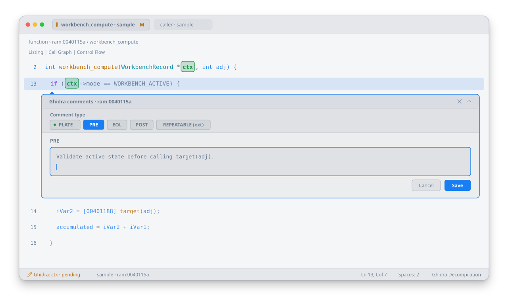
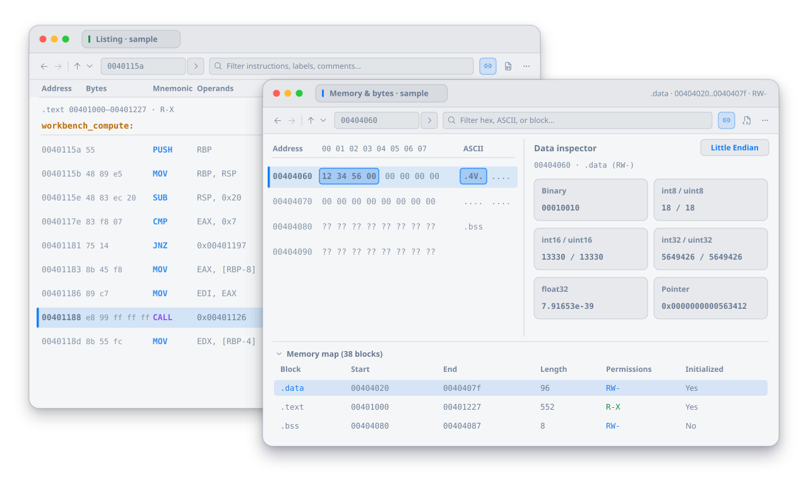
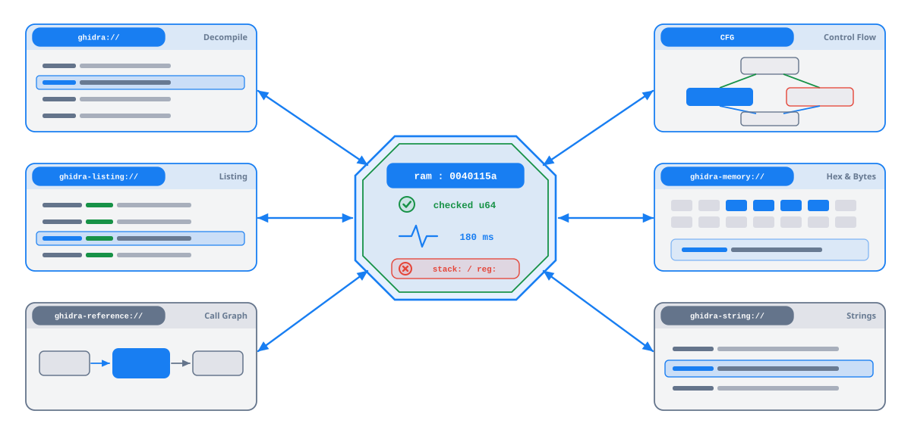
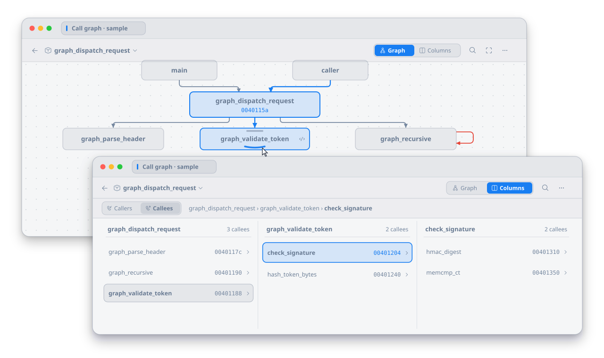

# Visual Studio Code Guide

The Visual Studio Code extension in `editors/vscode/` integrates `ghidra-lsp` into native editor tabs, Activity Bar tree views, custom graphical editors, and synchronized analysis webviews.


## Installation and VSIX packaging

### Build from source

Building the extension requires VS Code `^1.96.0`, Node.js, and `npm`:

```sh
npm --prefix editors/vscode install
npm --prefix editors/vscode run check
npm --prefix editors/vscode run package
```

`npm run package` runs `vsce package` and writes `ghidra-lsp-<version>.vsix` inside `editors/vscode/`.

Install the VSIX from the terminal or through the VS Code Extensions view (**Install from VSIX...**):

```sh
code --install-extension editors/vscode/ghidra-lsp-<version>.vsix
```

For local extension development, open `editors/vscode/` in VS Code and press `F5` to start an Extension Development Host.

## Extension settings

When `ghidraLsp.serverPath` (`"ghidra-lsp"`) and `ghidraLsp.mcpCommand` (`"ghidra-mcp"`) keep their defaults and are missing from `PATH`, the extension installs `@ghidra-lsp/cli` and `@ghidra-mcp/cli` via `npm` into the shared managed bin directory (`~/.local/share/ghidra-lsp/bin` on Linux and macOS, or `%LOCALAPPDATA%\ghidra-lsp\bin` on Windows). Configure `ghidra-lsp` in User or Workspace `settings.json`:

```json
{
  "ghidraLsp.autoInstall": true,
  "ghidraLsp.serverPath": "ghidra-lsp",
  "ghidraLsp.mcpCommand": "ghidra-mcp",
  "ghidraLsp.mcpArgs": [],
  "ghidraLsp.requestTimeoutMs": 35000,
  "ghidraLsp.liveRefreshIntervalMs": 2000,
  "ghidraLsp.templateArguments": "omit",
  "ghidraLsp.views.syncCursor": true,
  "files.autoSave": "off",
  "files.refactoring.autoSave": false
}
```

| Setting | Type and default | Behavior |
| --- | --- | --- |
| `ghidraLsp.autoInstall` | `boolean`, `true` | Automatically install missing default `ghidra-lsp` and `ghidra-mcp` binaries via `npm` into the shared user bin directory |
| `ghidraLsp.serverPath` | `string`, `"ghidra-lsp"` | Path to the `ghidra-lsp` executable (restart extension after changing) |
| `ghidraLsp.mcpCommand` | `string`, `"ghidra-mcp"` | Path or command name for the `ghidra-mcp` child process |
| `ghidraLsp.mcpArgs` | `string[]`, `[]` | Extra CLI arguments forwarded to `ghidra-mcp` |
| `ghidraLsp.requestTimeoutMs` | `number`, `35000` (`100..300000`) | Timeout in milliseconds for backend MCP requests |
| `ghidraLsp.liveRefreshIntervalMs` | `number`, `2000` (`0` disables) | Background polling interval to refresh visible, unmodified functions |
| `ghidraLsp.templateArguments` | `"omit"` or `"show"`, `"omit"` | Display outer C++ template lists as `<…>` (`"omit"`) or full lists (`"show"`) |
| `ghidraLsp.views.syncCursor` | `boolean`, `true` | Synchronize cursor selections across open Program Listing, Hex View, Control Flow, and Decompiler tabs |

Set `"files.autoSave": "off"` and `"files.refactoring.autoSave": false` when you want manual confirmation before `<F2>` rename previews or `.ghidra-type` edits save to Ghidra.

## Activity Bar and sidebar views

Click the **Ghidra** icon (`resources/ghidra.svg`) in the Activity Bar to open four sidebar views:

1. **Sessions (`ghidra.sessions`, collapsed by default)**: Lists open, closed, or stale Ghidra sessions and active background import/analysis tasks. Includes toolbar actions to open a binary, refresh sessions, or stop waiting on an analysis progress dialog.
2. **Symbols (`ghidra.symbols`)**: Displays program functions, symbols grouped by C++ namespace, and recent programs. When no program is open, displays welcome links for **Open Binary**, **Open Recent Program**, and **select an open session**.
3. **Strings (`ghidra.strings`, collapsed by default)**: Lists defined strings in the active program with address and decoded text. Selecting a string opens a read-only `ghidra-string://` tab with a reference-count CodeLens (`Shift+F12`).
4. **Data Types (`ghidra.types`)**: Shows the project category tree for structs, unions, enums, function definitions, typedefs, and primitives, with create, edit, and delete actions.

## Custom editors and virtual documents

### Decompiled C tabs (`ghidra://`)

Functions open in language `ghidra-decompiled` (`syntaxes/ghidra.tmLanguage.json`). The buffer is read-only for arbitrary typing and supports native Hover, Definition, Type Definition, References (`ghidra-reference://` readable peek previews), Call Hierarchy, Document Symbols, Inlay Hints, Semantic Tokens, Folding Ranges, and Document Links. Function header CodeLens actions show `Listing`, `Call Graph`, and `Control Flow`, because VS Code filters out `Callers`, `Callees`, and `References` in favor of native Peek and Call Hierarchy. Use `<F2>` for scoped renames and Code Actions (`Ctrl+.` / `Cmd+.`) for comments and symbol edits.

Running **Ghidra: Edit Comment** or the comment Code Action opens a native VS Code `CommentThread` beside the statement. The top **Comment type** row shows five horizontal badge tabs (`PLATE`, `PRE`, `EOL`, `POST`, and `REPEATABLE (ext)`) with populated indicators, and clicking any badge runs `ghidraLsp.selectCommentKind` (**Switch Comment Kind**) to switch the single inline editor below to that category with **Edit**, **Save**, and **Cancel** controls.



### Analysis and Control Flow (`ghidra.analysisControlFlow` and `ghidra-listing://`)

Run **Ghidra: Open Analysis Views** (`ghidraLsp.openViews`) from a decompiled function to open a synchronized analysis tab beside the pseudocode. Use **Ghidra: Switch Analysis View…** (`ghidraLsp.analysisView`) or editor toolbar buttons to switch the tab representation without losing cursor context:

- **Listing** (`ghidra-listing` mode): Native virtual disassembly text (`editor.wordWrap: "on"` by default) with toolbar actions to jump to containing function, list references, switch to Bytes, copy address, open the graphical Program Listing, or refresh.
- **Bytes** (`ghidra-memory` mode): Aligned 16-byte hexadecimal and ASCII dump (`ghidra-memory` grammar).
- **Control Flow** (`ghidra.analysisControlFlow` custom editor): Interactive ELK-laid-out basic-block CFG webview with rounded basic-block cards (`Entry` badge on the entry block), rounded orthogonal branch edges, a bottom-right **Overview** minimap, and zoom controls. Selecting or double-clicking a basic block highlights and reveals the corresponding pseudocode or listing range.

### Memory Map and Program Listing webviews



Run **Ghidra: Program Listing** (`ghidraLsp.browseListing`) or **Ghidra: Memory and Bytes (Hex)** (`ghidraLsp.showMemory`) to open full graphical workbench panels with a compact navigation toolbar:

- **Program Listing**: Displays memory-block headers with permissions (`R/W/X`), collapsed undefined byte runs, function signatures, plate/pre/eol/post comments, mnemonic columns, and cross-reference counts with navigation history and subtle active-row highlights.
- **Memory and Bytes (Hex)**: Displays a collapsible **Memory map** table, block selector, 8-byte or 16-byte row width, hex/ASCII cursor selection, and a 2-column **Data inspector** card grid decoding `Binary`, `int8 / uint8`, `int16 / uint16`, `int32 / uint32`, `int64 / uint64`, `float32`, `float64`, `Pointer`, `ASCII`, and `UTF-8` with a live **Little Endian** / **Big Endian** toggle pill that re-decodes values on click.

### Bidirectional view synchronization



When `ghidraLsp.views.syncCursor` is enabled, `ViewSets` and `Workbench` keep cursor selections synchronized across the active Decompiler `ghidra://` tab, native `ghidra-listing://` / `ghidra-memory://` tabs, `Control Flow` custom editors, and graphical **Program Listing** / **Memory and Bytes** webviews using checked `u64` address ranges and `ghidra.location` / `ghidra.reveal`.

### Call Graph and Miller Column Path Explorer



Run **Ghidra: Call Graph** (`ghidraLsp.showCallGraph`), **Ghidra: Callers** (`ghidraLsp.showCallers`), or **Ghidra: Callees** (`ghidraLsp.showCallees`), and switch between modes at any time from the topbar `[Graph | Columns]` segmented switch beside the search button:

- **Graph mode (`call-graph.ts`)**: Renders a top-to-bottom layered orthogonal SVG graph computed with `elkjs`. Compact rounded function cards connect with rounded orthogonal edges, and the root card displays the entry address subtitle. Resting cards stay centered and clear. Hovering or focusing any card reveals inner horizontal grabber bars along its top (`callers`) and bottom (`callees`) edges that bend toward the expand or collapse direction, plus the decompile button, supporting bidirectional interactive expansion on all discovered nodes. Server bounds cap neighborhoods at 80 nodes, 240 edges, and 40 backend queries.
- **Columns mode (`call-columns.ts`)**: Opens a Miller-column browser with labeled **Callers** / **Callees** direction toggles, an interactive breadcrumb trail, per-row short address hints beside function names, per-column search filtering (up to 200 sorted rows per column), recursive cycle return badges, and path depth up to 20 hops.

### Data Type Editor (`ghidra.dataTypeEditor` and `ghidra-type://`)


Opening a project data type opens a canonical `ghidra-type://<md5><path>.ghidra-type` virtual document in the **Ghidra Data Type Editor** custom form editor by default and validates it through `jsonValidation` (`editors/vscode/schemas/data-type.schema.json`) without adding a `"$schema"` property to the buffer. Both the JSONC text view and the **Ghidra Data Type Editor** custom form editor share the same underlying `TextDocument`. The graphical editor displays a visible header with the type kind badge, category path, byte size, member count, status indicator, inline read-only reason banner when applicable, and a **JSONC** button to open the raw `.ghidra-type` text side by side. It also provides focused row highlights, a dashed `+ Add field` row slot, drag or arrow row reordering, live diagnostics, **Compare Data Type with Ghidra**, **Reload Data Type from Ghidra**, and readback normalization on save.

## Keybindings

| Shortcut | Command | When clause |
| --- | --- | --- |
| `Ctrl+.` (`Cmd+.` on macOS) | `ghidraLsp.codeActions` | Inside `ghidra://` with `ghidra-decompiled` focus and rename input hidden |
| `F2` | `ghidraLsp.renameSymbol` | Inside `ghidra://` function buffer and rename input hidden |
| `Ctrl+S` (`Cmd+S` on macOS) | `ghidraLsp.saveRename` | Inside `ghidra://` buffer and rename input hidden |

## Complete VS Code command reference

### Sessions and analysis

- `ghidraLsp.openBinary`: **Ghidra: Open Binary**
- `ghidraLsp.openRecent`: **Ghidra: Open Recent Program**
- `ghidraLsp.openRecentItem`: **Ghidra: Reopen Session**
- `ghidraLsp.selectSession`: **Ghidra: Select Session**
- `ghidraLsp.selectSessionItem`: **Ghidra: Switch to Session**
- `ghidraLsp.refreshSessions`: **Ghidra: Refresh Sessions**
- `ghidraLsp.programOverview`: **Ghidra: Program Overview**
- `ghidraLsp.reanalyze`: **Ghidra: Reanalyze Program**
- `ghidraLsp.cancelAnalysis`: **Ghidra: Stop Waiting for Analysis**
- `ghidraLsp.closeSession`: **Ghidra: Close Program**
- `ghidraLsp.installBinaries`: **Ghidra: Install or Update Binaries**

### Navigation, catalogs, and inspection

- `ghidraLsp.openFunction`: **Ghidra: Open Function**
- `ghidraLsp.goToAddress`: **Ghidra: Go to Address**
- `ghidraLsp.demangle`: **Ghidra: Demangle C++ Symbols**
- `ghidraLsp.refresh`: **Ghidra: Refresh Documents**
- `ghidraLsp.refreshBrowser`: **Ghidra: Refresh Program Browser**
- `ghidraLsp.refreshStrings`: **Ghidra: Refresh Strings**
- `ghidraLsp.browseSymbol`: **Show Symbol Details**
- `ghidraLsp.functionDetails`: **Ghidra: Function Details**
- `ghidraLsp.inspectType`: **Ghidra: Inspect Type at Cursor**

### Renames, comments, prototypes, and globals

- `ghidraLsp.renameSymbol`: **Ghidra: Rename Symbol**
- `ghidraLsp.saveRename`: **Ghidra: Submit Pending Rename**
- `ghidraLsp.saveAllRenames`: **Ghidra: Submit All Pending Renames**
- `ghidraLsp.showPendingRename`: **Ghidra: Show Pending Rename**
- `ghidraLsp.discardRename`: **Ghidra: Discard Pending Rename**
- `ghidraLsp.codeActions`: **Ghidra: Code Actions…**
- `ghidraLsp.editComment`: **Ghidra: Edit Comment**
- `ghidraLsp.editCommentText` / `ghidraLsp.selectCommentKind` / `ghidraLsp.saveComment` / `ghidraLsp.cancelCommentEdit` / `ghidraLsp.closeCommentEditor`: Inline comment thread controls (**Edit**, **Switch Comment Kind**, **Save**, **Cancel**, **Close comment editor**)
- `ghidraLsp.editFunction`: **Ghidra: Edit Function Signature**
- `ghidraLsp.editVariables`: **Ghidra: Edit Variables and Parameters**
- `ghidraLsp.editSymbol`: **Ghidra: Edit Global Symbol**

### Data types

- `ghidraLsp.createType`: **Ghidra: Create Data Type**
- `ghidraLsp.editType`: **Ghidra: Edit Data Type**
- `ghidraLsp.deleteType`: **Ghidra: Delete Data Type**
- `ghidraLsp.applyType`: **Ghidra: Apply Data Type**
- `ghidraLsp.typeDetails`: **Ghidra: Data Type Details**
- `ghidraLsp.compareType`: **Ghidra: Compare Data Type with Ghidra**
- `ghidraLsp.reloadType`: **Ghidra: Reload Data Type from Ghidra**

### Analysis views, listings, memory, and graphs

- `ghidraLsp.openViews`: **Ghidra: Open Analysis Views**
- `ghidraLsp.analysisView`: **Ghidra: Switch Analysis View…**
- `ghidraLsp.showListing`: **Ghidra: Disassembly Listing**
- `ghidraLsp.browseListing`: **Ghidra: Program Listing**
- `ghidraLsp.showMemory`: **Ghidra: Memory and Bytes (Hex)**
- `ghidraLsp.listingFunction`: **Ghidra: Open Containing Function**
- `ghidraLsp.listingReferences`: **Ghidra: References at Address**
- `ghidraLsp.listingBytes`: **Ghidra: Switch to Bytes**
- `ghidraLsp.bytesListing`: **Ghidra: Switch to Listing**
- `ghidraLsp.listingCopyAddress`: **Ghidra: Copy Address**
- `ghidraLsp.listingBrowse`: **Ghidra: Open in Program Listing**
- `ghidraLsp.listingRefresh`: **Ghidra: Refresh Listing**
- `ghidraLsp.showStrings`: **Ghidra: Strings**
- `ghidraLsp.showImports`: **Ghidra: Imports**
- `ghidraLsp.showExports`: **Ghidra: Exports**
- `ghidraLsp.showReferences`: **Ghidra: Address References**
- `ghidraLsp.showAddressReferences`: **Ghidra: Binary Address References**
- `ghidraLsp.showControlFlow`: **Ghidra: Control Flow Graph**
- `ghidraLsp.showCallGraph`: **Ghidra: Call Graph**
- `ghidraLsp.showCallers`: **Ghidra: Callers**
- `ghidraLsp.showCallees`: **Ghidra: Callees**
- `ghidraLsp.showCallHierarchy`: **Ghidra: Show Call Hierarchy**

Next chapter: [Neovim Guide](neovim-guide.md).
