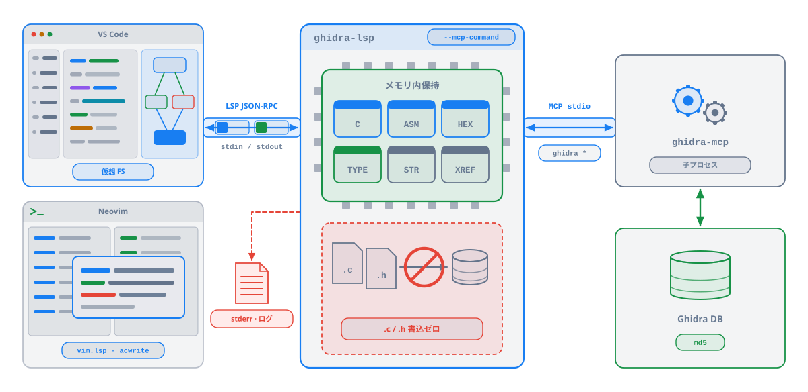

# ghidra-lsp


[](../../README.md)
[](../zh-CN/README.md)


**`ghidra-mcp` を介して Ghidra のライブ逆コンパイルを IDE に提供する Language Server**

[クイックスタート](getting-started.md) · [アーキテクチャ](architecture.md) · [VS Code ガイド](vscode-guide.md) · [Neovim ガイド](neovim-guide.md) · [編集と安全性](editing-and-safety.md) · [LSP と開発規約](lsp-and-development.md)

---

`ghidra-lsp` は、Model Context Protocol（MCP）経由で起動する [`ghidra-mcp`](https://github.com/byteland-app/ghidra-mcp) 子プロセスとエディタクライアントを接続する Rust 製の Language Server Protocol（LSP）サーバーです。逆コンパイル済み C 擬似コード、アセンブリリスティング、メモリダンプ、定義済み文字列、制御フローグラフ（CFG）、コールグラフ、および構造化データ型エディタをすべてメモリ上の仮想ドキュメントとして提供し、ディスクへ `.c` や `.h` ファイルを一切書き出しません。

## 主な特徴

- **ゼロディスク出力の仮想ドキュメント**: `ghidra://`、`ghidra-listing://`、`ghidra-memory://`、`ghidra-type://`、`ghidra-string://`、`ghidra-reference://` の 6 つの仮想 URI スキームで解析ビューをすべてプロセス内メモリに保持します。
- **シングルデコンパイル予算の精密アライメント**: 1 回の `decompilation.get`（`format: "document"`, `include_comments: true`）呼び出しで C テキスト、GUI トークン、カーソル／コードユニットアドレス、および 5 種類のコメント（`plate`、`pre`、`eol`、`post`、`repeatable`）を取得し、UTF-8 文字境界と UTF-16 LSP 座標に正確に対応付けます。
- **制御された永続化と安全性**: 読み取り専用 C 擬似コードに対するスコープ付き `<F2>` 名前変更プレビューとオリジン保存コミット、楽観的競合検出（Conflict Check）、書き込みタイムアウト後のバックエンド状態再読込リカバリ、および `all_or_none` バッチ変更を実装しています。
- **リッチな LSP コードインテリジェンス**: ホバー、定義／宣言／実装／型定義へのジャンプ、相互参照、セマンティックトークン、コードレンズ、インレイヒント（ローカル変数ストレージとコール先アドレス）、折りたたみ範囲、ドキュメントリンク、コール階層、補完、シグネチャヘルプを提供します。
- **デュアルエディタ統合**:
  - **Visual Studio Code 拡張機能**（[editors/vscode/README.md](../../editors/vscode/README.md)）: Program Browser サイドバー、双方向カーソル同期付きの Listing / Hex + Data Inspector / Control Flow ビュー、`[Graph | Columns]` 切替とホバー内縁グラバーバーを備えた Call Graph と Miller カラム探索、JSONC およびグラフィカル Data Type Editor、横並び 5 種バッジタブ付きインラインコメントスレッドを備えています。
  - **Neovim プラグイン**（[editors/nvim/README.md](../../editors/nvim/README.md)）: 32 個の `:Ghidra*` コマンド（`:GhidraInstall`、チェックポイント復元、セッションリセットを含む）、`:GhidraEditType` によるライブ診断付き `.ghidra-type` JSONC 編集、フローティング 5 種コメントエディタ、関数プロトタイプ／変数フォーム、仮想 Listing / Hex / CFG / Call Graph バッファを備えています。



## ビジュアルツアー

### VS Code ワークベンチ: 逆コンパイルと制御フローグラフ（CFG）


### Neovim ワークベンチ: 仮想バッファとフローティング編集 UI


## クイックインストール・ビルド

### npm でインストール

Node.js 18 以上が利用可能な環境では、npm から各プラットフォーム向けのビルド済みバイナリをインストールできます。

```sh
npm install --global @ghidra-lsp/cli
ghidra-lsp --version
```

または `npx` で直接実行できます。

```sh
npx @ghidra-lsp/cli --version
```

npm は現在の環境に一致するプラットフォームパッケージ（`@ghidra-lsp/linux-x64` など）を 1 つだけインストールします。プラットフォームパッケージは `optionalDependencies` のため、`--omit=optional` は指定しないでください。Linux パッケージは glibc が必要です。musl 環境ではソースからビルドしてください。

### ソースからビルド・検証

前提条件として **Rust 1.88 以上**、**Ghidra**、および実行可能な `ghidra-mcp` が必要です。

```sh
cargo build --locked --release
```

リポジトリ規約と CI チェック一式（フォーマット、ライセンスヘッダ、行数制限、禁止コード検査、Clippy、ドキュメントビルド、依存関係検査）は次で実行できます。

```sh
cargo xtask ci
```

リリース時には [CI ワークフロー](../../.github/workflows/ci.yml) が `release-please` による Rust・npm・VS Code 拡張機能のバージョン同期、6 プラットフォームのバイナリと VS Code `.vsix` パッケージの生成、GitHub Release への公開、GitHub OIDC Trusted Publishing を用いた 6 つのプラットフォームパッケージと `@ghidra-lsp/cli` の npm 公開および Visual Studio Marketplace への公開（`OVSX_PAT` 設定時は Open VSX への公開を含む）を実行します。

CLI オプションの概要は次のとおりです（詳細は [クイックスタート](getting-started.md) を参照してください）。

| フラグ | デフォルト | 説明 |
| --- | --- | --- |
| `--mcp-command <CMD>` | `ghidra-mcp` | `ghidra-mcp` 子プロセスの実行ファイル名またはパス |
| `--mcp-arg <ARG>` | なし（複数指定可） | `ghidra-mcp` 子プロセスへ渡す追加引数 |
| `--request-timeout-ms <MS>` | `35000` | バックエンド MCP 呼び出しのタイムアウト（ミリ秒、100〜300000 の範囲に制限） |

## ワークスペース構成

- `src/`: `ghidra-lsp` バイナリクレートの Rust ソースコード（`src/main.rs` が単一エントリポイント）。
- `xtask/`: `cargo xtask ci` などのリポジトリ検査ランナー。
- `editors/vscode/`: Visual Studio Code クライアント拡張機能（[VS Code README](../../editors/vscode/README.md)）。
- `editors/nvim/`: Neovim クライアントプラグイン（[Neovim README](../../editors/nvim/README.md)）。
- `docs/`: 英語・簡体字中国語・日本語のドキュメントと SVG 図版／スクリーンショット。

## ドキュメント一覧

| 章 | 内容 | リンク |
| --- | --- | --- |
| クイックスタート | 前提環境、ビルド、CLI オプション、初期動作確認、トラブルシューティング | [getting-started.md](getting-started.md) |
| アーキテクチャ | プロセス境界、6 つの仮想 URI、正規化 ID、UTF-16 整合、単一デコンパイルパイプライン | [architecture.md](architecture.md) |
| VS Code ガイド | サイドバー、カスタムエディタ、グラフ、Hex インスペクタ、設定とコマンド一覧 | [vscode-guide.md](vscode-guide.md) |
| Neovim ガイド | 導入設定、32 個の `:Ghidra*` コマンド、キーマップ、フローティング編集 UI | [neovim-guide.md](neovim-guide.md) |
| 編集と安全性 | 読み取り専用保証、`<F2>` スコープ付きリネーム、プロジェクトチェックポイントとセッションリセット、5 種コメント、データ型 JSONC スキーマ | [editing-and-safety.md](editing-and-safety.md) |
| LSP と開発規約 | LSP ケーパビリティ行列、全 49 個の `ghidra.*` カスタムコマンド、`AGENTS.md` と `cargo xtask ci` | [lsp-and-development.md](lsp-and-development.md) |

## ライセンス

Copyright 2026 ByteLand Technology Limited — [MIT License](../../LICENSE) の下で公開されています。
