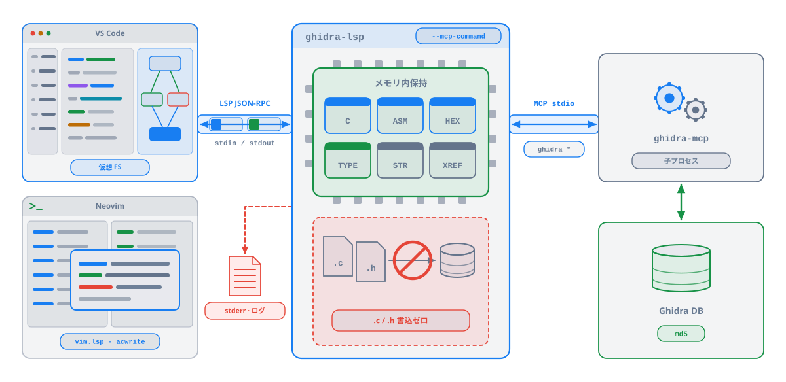
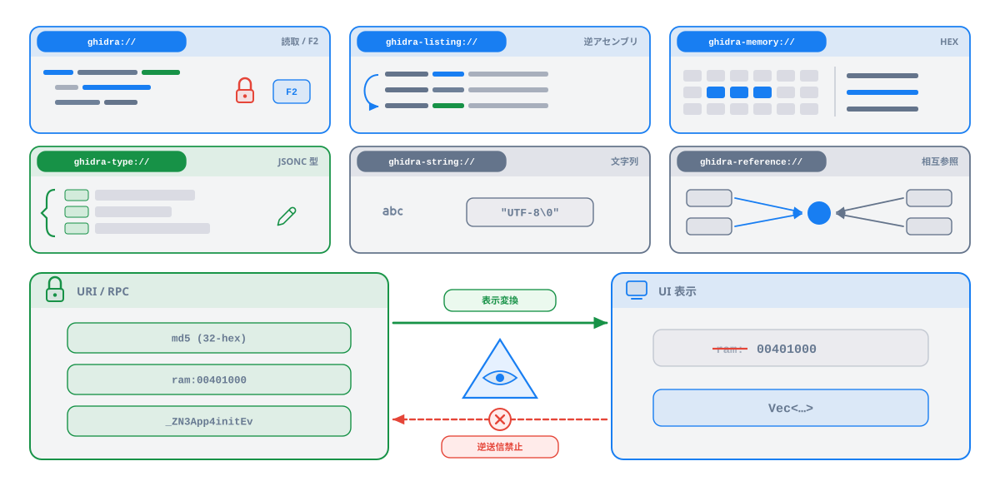
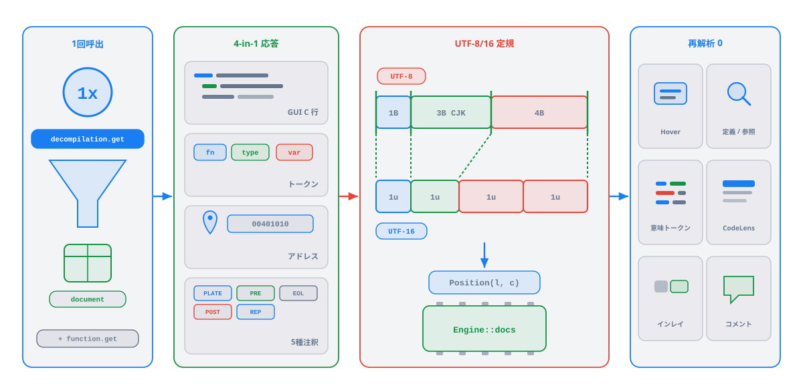

# アーキテクチャ

この章では、`ghidra-lsp` のプロセス構成、厳格な入出力とゼロディスク境界、6 つの仮想 URI スキーム、正規化識別子のルール、UTF-8／UTF-16 テキスト整合、および単一デコンパイルリクエスト予算の仕組みを解説します。

## プロセスモデルと独立性

`ghidra-lsp` は `ghidra-mcp` のワークスペースクレートではなく、完全に独立した単体バイナリです（`Cargo.toml` にパス依存や Git 依存を持ちません）。実行時には次の 3 層で動作します。

1. **エディタクライアント（VS Code / Neovim）** ↔ **`ghidra-lsp`**: 標準入力（`stdin`）と標準出力（`stdout`）を使い、LSP JSON-RPC 2.0 フレーム（`Content-Length` ヘッダ付き）で通信します。
2. **`ghidra-lsp`** → **ログ出力**: すべての診断ログおよび子プロセスのエラー出力は `stderr` のみに送出され、`stdout` の JSON-RPC ストリームを決して汚染しません。
3. **`ghidra-lsp`** ↔ **`ghidra-mcp`（子プロセス）**: `McpBackend`（`src/backend.rs`）が初回バックエンド呼び出し時に `ghidra-mcp` を遅延起動（`TokioChildProcess`、`kill_on_drop(true)`）し、MCP 標準入出力経由で `ghidra_<domain>` ツールを実行します。

### ゼロディスク出力ポリシー

逆コンパイルされた C 擬似コード、アセンブリリスティング、バイトウィンドウ、文字列、参照スナップショット、および JSONC データ型ドラフトは、すべて `Engine::docs`（サーバーメモリ）およびエディタ拡張の仮想ファイルシステムプロバイダ（プロセスメモリ）に保持されます。ローカルディスク上へ一時的な `.c` や `.h` ファイルを書き出すことは一切ありません。

## 6 つの仮想 URI スキーム

解析ビューは対象ごとに専用の URI スキームへ分離されており、タブの識別子（プログラム MD5 とアドレスまたはパス）が URI 自体に埋め込まれます。

| スキーム | 主な URI 形式 | 用途と編集可否 |
| --- | --- | --- |
| `ghidra://` | `ghidra://<md5>/function/<entry>`、`ghidra://<md5>/symbol/<id>`、`ghidra://<md5>/references/<address>`、`ghidra://<md5>/type/<path>` | 関数擬似コード（読み取り専用。`<F2>` リネームプレビュー＋オリジン保存のみ可）および各種解析スナップショット（読み取り専用） |
| `ghidra-listing://` | VS Code: `ghidra-listing://<md5>/listing/<addr>.ghidra-listing`、Neovim: `ghidra-listing://<md5>/<addr>` | ページングされたプログラムアセンブリリスティング。VS Code では同じリソースを Listing / Bytes / Control Flow カスタムエディタ間で切り替え可能 |
| `ghidra-memory://` | VS Code: `ghidra-memory://<md5>/memory/<addr>.ghidra-bytes`、Neovim: `ghidra-memory://<md5>/<addr>` | 境界付き 16 進バイトダンプ＋ライブ Data Inspector（整数、浮動小数点、ポインタ、文字列デコード） |
| `ghidra-type://` | VS Code: `ghidra-type://<md5><path>.ghidra-type?v=3`、Neovim: `ghidra-type://<md5><path>.ghidra-type` | 編集可能な `.ghidra-type` JSONC 仮想ファイル（`struct` / `union` / `enum` / `function`）。組み込み型や `typedef` 等は読み取り専用 |
| `ghidra-string://` | VS Code: `ghidra-string://<md5>/string/<addr>?{"address":"..."}`、Neovim: `ghidra-string://<md5>/string/<addr>` | 定義済み文字列のプレーンテキスト表示。選択・コピー・相互参照検索に対応 |
| `ghidra-reference://` | VS Code: `ghidra-reference://<md5>/<id>/<label>?{"source":"..."}` | VS Code の Peek References 表示で人間が読みやすいラベルを提示し、タブを確定すると元の `ghidra://` または `ghidra-listing://` へリダイレクト |

> [!NOTE]
> Neovim プラグインでは上記 6 スキームに加え、クライアント側の分割ウィンドウやフローティング UI を識別するためのバッファ名として `ghidra-overview://<md5>`、`ghidra-cfg://<md5>/<entry>`、`ghidra-callgraph://<md5>/<entry>`、`ghidra-comment://<md5>/<addr>`、および `ghidra-edit-fn://<md5>/<entry>` を使用します。

## 正規化識別子と表示用フォーマットの分離

サーバーおよびエディタは、**内部アイデンティティの厳密性**と**画面表示の読みやすさ**を明確に分離しています。

- **変更せず保持するもの（URI・RPC ペイロード）**:
  - 32 桁小文字 16 進数のプログラム `md5` ハッシュ（`scoped_md5` で小文字正規化と 32 桁 16 進検証を実施）。
  - `space:offset` 形式の正規アドレス（例: `ram:00401000`、`EXTERNAL:00000010`）。
  - Ghidra の安定シンボル ID、および生のマングル名（`symbol.name`）。
  - URL エンコードのみが適用された関数エントリや型パス。VS Code では型ファイル拡張子 `.ghidra-type` を末尾に付けることで、`*.h` などの一般ファイル関連付けと衝突するのを防いでいます（`editors/vscode/src/virtual-files.ts`）。
- **UI 表示専用フォーマット（画面・ツールチップ・一覧）**:
  - **`ram:` アドレスの省略**（`src/address.rs` の `display_address`）: `ram:` で始まり残りが 16 進数のみの文字列に限り、`ram:` プレフィックスを省いた裸の 16 進数（例: `00401000`）で表示します。`EXTERNAL:` など他のアドレス空間はそのまま維持します。
  - **C++ テンプレート引数の折りたたみ**（`src/document.rs` の `brief_templates`）: `templateArguments` が `"omit"`（デフォルト）の場合、外側の `<...>` テンプレート引数リストを `<…>` に省略します。ただし `operator<<` などの演算子名や `<EXTERNAL>` 名前空間は破壊せず、完全なデマングル名と生マングル名はホバーとツールチップに残します。

## チェック付きアドレス演算と UTF-8 / UTF-16 整合

バイナリ解析および LSP 座標計算では、境界バグを防ぐために厳密な数値・文字処理を行っています。

- **チェック付き `u64` アドレス演算**（`src/address.rs`）:
  - `parse_address` は非メモリ空間プレフィックス（`stack:`、`register:`、`const:`、`unique:`、`variable:`、`hash:`）や配列添字表現を除外し、有効な空間名と 64 ビットオフセットへ分解します。
  - `add_address_offset` は `i128` 上の `checked_add` を使って `0..=u64::MAX` の範囲外オーバーフロー／アンダーフローを確実に拒否します。
- **UTF-8 スライスと UTF-16 LSP 座標**（`src/document.rs`、`src/gui.rs`）:
  - テキスト内のオフセット計算や識別子検出では UTF-8 の文字境界（`is_char_boundary`）のみを使用します。
  - LSP サーバーは `PositionEncodingKind::UTF16` を宣言し、すべての `Position`、`Range`、およびセマンティックトークンの位置・長さ（`encode_utf16().count()`）を UTF-16 コード単位で計算します。

## シングルデコンパイル予算とトークン整合パイプライン

関数を開くたびに複数回の逆コンパイルを走らせることを防ぐため、`Engine::generate_inner`（`src/engine/mod.rs`）は **単一デコンパイルリクエスト予算** を徹底しています。

1. **1 回の `decompilation.get` 呼び出し**:
   `selector: {"entry": entry}`, `scan: {"timeout_ms": 30000}`, `format: "document"`, `include_comments: true` を送信し、逆コンパイル済み C テキスト（`c`）、GUI の行・インデント・トークン列（`lines`）、各トークンのアドレス・`code_unit_address`・`max_address`・`symbol` メタデータ、および補足コメント（`repeatable`）を一度に取得します。
2. **ネイティブ GUI レイアウト検証**（`src/gui.rs`）:
   受信した `lines` 配列の各行番号・インデント・UTF-16 開始／終了カラムからテキストを再構成し、`c` テキストと 1 バイト違わず一致することを検証したうえで `Span` 列を構築します。
3. **補足コメントの埋め込みとスパン補正**（`src/comments.rs`）:
   `decompilation.get` に含まれる `repeatable` コメントを対応するコードユニット行へ挿入し、すべての `Span` バイトオフセットをシフトして整合性を保ちます（`plate`、`pre`、`eol`、`post` は GUI レイアウトに含まれるため合計 5 種類のコメントが 1 リクエストに揃います）。
4. **シンボル解決とローカルメタデータ保持**:
   `function.get` とキャッシュ済み `symbol.list`（`list_all` による `page.limit = 1000` ページング）を結合し、ローカル変数・パラメータの型やストレージ情報（`register` / `stack`）を `local_details` に紐付けます。
5. **単一リクエストからの機能派生**:
   こうして構築された `Document` と `Span` 列から、ホバー、定義ジャンプ、型定義ジャンプ、ハイライト、セマンティックトークン、コードレンズ、インレイヒント、ドキュメントリンク、フォールディング範囲、コードアクションが追加の逆コンパイルなしで即座に応答されます。

## モジュール別ドメイン構成

`src/` 配下の責務分離は次のとおりです。

| モジュール | 責務 |
| --- | --- |
| `src/main.rs` | CLI 引数解析と LSP サービス起動（`src/lib.rs` は配置しない構成） |
| `src/backend.rs` | `ghidra-mcp` 子プロセスの遅延起動、タイムアウト・セッションリセット、レスポンス正規化 |
| `src/address.rs` | `space:offset` アドレス解析、チェック付き `u64` 演算、C 型表記パーサ、定義済み文字列抽出 |
| `src/binary.rs` | バイナリファイルの MD5 照合と `object` クレートによる PE / ELF / Mach-O インポート・エクスポート解析（最大 2 GiB） |
| `src/document.rs` & `src/gui.rs` & `src/comments.rs` | 仮想バッファ状態、ネイティブ GUI レイアウト検証、5 種コメント挿入、UTF-16 変換、テンプレート引数表示整形 |
| `src/engine/` | セッション管理、シンボル解決、コードインテリジェンス（補完・ナビゲーション・装飾・コール階層）、スコープ付きリネーム制御 |
| `src/mutations/` | 5 種コメント編集プランおよび関数プロトタイプ・ローカル変数の `all_or_none` バッチ変更 |
| `src/types_doc/` | `.ghidra-type` JSONC レキサ／AST パーサ、スキーマ検証、競合検出、正規化書き戻し |
| `src/views/` | ウィンドウ付きアセンブリリスティング、メモリ 16 進ダンプ、Data Inspector デコード、`ViewCache` |
| `src/graph/` | 基本ブロック制御フローグラフ（CFG）構築と上限付きコールグラフ探索（最大 80 ノード / 240 エッジ） |
| `src/workbench.rs` | セマンティックトークン生成と `ghidra.query` / `ghidra.mutate` のホワイトリスト検閲 |
| `src/server/` | `LanguageServer` トレイト実装、45 個の `workspace/executeCommand` ディスパッチ、診断通知、非同期オープン進捗追跡 |

次の章: [VS Code ガイド](vscode-guide.md) または [Neovim ガイド](neovim-guide.md)。
