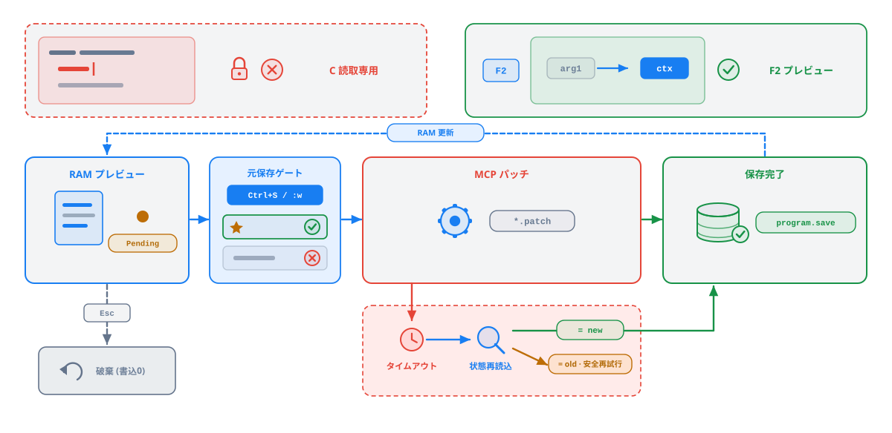
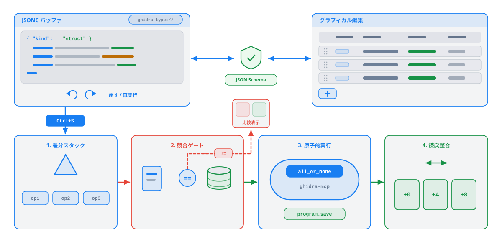

# 編集と安全性

逆コンパイラ生成テキストをそのまま自由編集・保存させると、C 構文の破壊やバックエンドとの不整合、意図しない上書きが発生します。`ghidra-lsp` は、**擬似コードを読み取り専用に保ったまま、構造化された安全な変更経路のみを許可する「制御された永続化（Controlled Persistence）」** を採用しています。

## 読み取り専用 C 擬似コードの保証

`ghidra://` 仮想ドキュメントはすべて読み取り専用（または `acwrite` 上でリネーム専用に制限）として管理されます。

- VS Code では `GhidraMemory` プロバイダが `FilePermission.Readonly` を設定し、`writeFile()` を常に拒否します。
- Neovim では `ghidra://` 関数バッファの `:w` 時に `ghidra.saveDocument` を呼び出し、サーバー側の `Engine::save` / `handle_save_document` がテキスト差分を検証します。有効なスコープ付き `<F2>` リネーム（または単一識別子リネーム）に一致しない任意テキスト編集の保存はサーバーが明確に拒否します。

## スコープ付き `<F2>` リネームとオリジン保存

シンボル名の変更は、まずローカルメモリ上のプレビューとして計画され、**変更を開始した元の関数バッファ（Origin）を明示的に保存したときだけ** Ghidra へ書き込まれます。



### ライフサイクルの手順

1. **準備と検証（`prepare_rename` / `rename`）**:
   - カーソル位置のシンボル（`Function`、`Label`、`Global`、`Local`、`Parameter`、`Constant`）と正確なトークン範囲を取得します。
   - 新しい名前が有効な ASCII 識別子（先頭数字不可、英数字と `_`）であることを検証し、関数内ローカル変数／パラメータとの名前衝突を事前に弾きます。
2. **スコープ付きプレビュー計画（`Pending`）**:
   - ローカル変数／パラメータの場合は**現在の関数ドキュメントのみ**、関数／グローバル／ラベルの場合は**同一プログラム `md5` で開かれているすべての `ghidra://` ドキュメント**を対象に `WorkspaceEdit` を生成し、`Engine::pending` に `Pending { origin, symbol, new_name, expected, patched: false }` を登録します。
   - この時点では `ghidra-mcp` への書き込みは一切発生しません。VS Code では対象タブに `M` バッジが表示され、Neovim ではステータスラインに保留中状態が表示されます。
3. **オリジン保存によるコミット（`Engine::save`）**:
   - オリジン以外のバッファで保存しても、バックエンド書き込みは走らず、エラー（Neovim）またはステータス保存のみとなります。
   - オリジンバッファを保存（VS Code で `Ctrl+S`/`Cmd+S` または **Ghidra: Submit Pending Rename**、Neovim で `:w`）すると、全対象ドキュメントに無関係な編集が混入していないことを検証したうえで、対象種別に応じたパッチ（`function.patch`、`symbol.patch`、`function.local_variable.patch`、`function.parameter.patch`）を送信します。
   - 変更は名前付き Ghidra トランザクションとしてメモリ上にコミットされ（自動 `program.save` は行わないため `ghidra.undo` / `ghidra.redo` で取り消し・やり直しが可能）、セッション内の全関数バッファとスナップショットを再生成・再同期します。明示的な `ghidra.saveProgram` または通常の `ghidra.closeSession` でディスクへ永続化され、`ghidra.resetSession` で未保存破棄と元のバイナリからの再インポートが可能です。
4. **取り消し（`ghidra.discardRename`）**:
   - バックエンド書き込み前（`patched == false`）であれば、いつでも変更をすべて元に戻してプレビューを破棄できます。

### 書き込みタイムアウト時の安全ガード

リネームパッチ送信直前に、サーバーは `pending.patched = true` を記録します（`src/engine/rename.rs`）。もしバックエンド呼び出しがタイムアウトした場合、`patched` は `true` のまま維持され、再試行前に必ずバックエンドの実際の状態を読み直します（`resolve_rename_target`）。

- バックエンド側で**すでに新しい名前に変わっていた場合**: 二重パッチを避け、そのまま保留状態のクリアと画面更新のみを完了させます。
- バックエンド側が**まだ元の名前のままだった場合**: `patched = false` へ戻し、「以前の書き込みは適用されませんでした。再度保存してください」と通知します。
- 外部から**別の名前に書き換えられていた場合**: 競合エラーとしてコミットを停止し、安全を守ります。

## 5 種類のコメントと関数メタデータ編集

### 5 種類の Ghidra コメント

`ghidra-lsp` は Ghidra が持つ 5 つのコメント区分すべてを同一のインターフェースで扱います（`src/mutations/mod.rs`）。VS Code のインラインコメントスレッド上部にある **Comment type** 横並びバッジタブ（`ghidraLsp.selectCommentKind`）と Neovim のフローティングコメントフッターの両方で、`PLATE`、`PRE`、`EOL`、`POST`、`REPEATABLE (ext)` の 5 区分を切り替えて単一エディタで編集できます（VS Code で `repeatable` を選択すると、下部の編集ボックス著者欄に `REPEATABLE` と `extension` ステータスが表示されます）。

| 区分（`kind`） | タブ表示ラベル | 意味と表示位置 |
| --- | --- | --- |
| `plate` | `PLATE` | 関数やコードブロックの先頭に付くプレートコメント（見出し枠） |
| `pre` | `PRE` | コードユニット（命令・式）の直前に挿入されるコメント |
| `eol` | `EOL` | 行末に付加されるエンドオブラインコメント |
| `post` | `POST` | コードユニットの直後に挿入されるコメント |
| `repeatable` | `REPEATABLE (ext)` | 定義箇所と参照箇所の両方に反映されるリピータブルコメント（`decompilation.get` 応答の補足挿入対象） |


`ghidra.saveComment` を実行すると、サーバーは事前に `ghidra.commentsAt` で現在のサーバー値を再取得し、クライアントが開いた時点の `expected` 値と一致しない場合は楽観的競合エラー（`This comment changed outside the editor.`）を返します。テキストを空（空白のみ）にして保存すると `comment.delete`、非空なら `comment.upsert` を名前付きトランザクションとして呼び出し、全バッファ更新を行います（`ghidra.undo` / `ghidra.redo` 対応）。

### 関数プロトタイプとローカル変数のバッチ変更

`ghidra.saveFunctionPrototype` と `ghidra.saveVariables`（`src/mutations/prototype.rs`）は、フォームを開いた時点の `original` スナップショットと現在の Ghidra 状態を照合し、外部変更があれば保存を拒否します。差分がない場合は何もしない、単一操作の場合は直接実行、複数操作（最大 1000 件）の場合は `batch.execute` に `"transaction_mode": "all_or_none"` を指定して複数変更（関数名、戻り値型、呼び出し規約、可変長引数、`noreturn`、`inline`、コメント、パラメータ追加・削除・変更、ローカル変数変更）を単一トランザクションとしてまとめて実行し、成功後にセッション再描画を行います（ディスク永続化は `ghidra.saveProgram` または通常のセッションクローズ時に行われます）。

## データ型編集（`ghidra-type://`）と JSONC スキーマ

`ghidra-type://<md5><path>.ghidra-type` は、VS Code ではテキストエディタ（JSONC）とグラフィカル **Ghidra Data Type Editor** が同一ファイルバッファを共有し、Neovim では `acwrite` JSONC バッファとして開かれます。




### サポートされる型と読み取り専用条件

編集可能な型カテゴリ（`kind`）は次の 4 種類です。

- `struct`（Ghidra 内部名 `structure`）
- `union`
- `enum`
- `function`（Ghidra 内部名 `function_definition`）

組み込み型、`typedef`、ポインタ型／配列型そのもの、長さ 0 以下のフィールド、ビットフィールド付きメンバー（`:N`）、`struct` 内の重複オフセット、規定数を超える匿名メンバー（`struct` で 2 個以上、`union` で 1 個以上）、IEEE-754 JSON 安全整数範囲（`-9007199254740991` 〜 `9007199254740991`）を超える値を含む `enum`、および構造化シグネチャを持たない関数定義は**自動的に読み取り専用**として開かれます。

### `data-type.schema.json` の主要フィールド

`editors/vscode/schemas/data-type.schema.json` と `src/types_doc/parse.rs` が強制する構造は次のとおりです（JSONC ドキュメント本文に `"$schema"` キーは記載せず、VS Code の `jsonValidation` パターン `ghidra-type:/**/*` とサーバー側検証でスキーマを適用します）。

| プロパティ | 対象 `kind` | ルールと制約 |
| --- | --- | --- |
| `path` | すべて | 必須・読み取り専用。別の型を作る場合は **Create Data Type** を使用 |
| `kind` | すべて | 必須・読み取り専用（`struct` / `union` / `enum` / `function`） |
| `fields` | `struct` / `union` | 要素は `{ id?, offset?, name, type, length? }`。`struct` は `offset`（`0..=2147483647`）が必須。`union` は `offset` 禁止かつ `name` 1 文字以上必須。`length` は省略時自動計算、指定時は `1..=2147483647` |
| `values` | `enum` | 要素は `{ id?, name, value }`。`name` は 1 文字以上必須、`value` は `-9007199254740991..=9007199254740991` の整数 |
| `signature` | `function` | `{ return_type, calling_convention, has_var_args, has_no_return, parameters: [{ name, type }] }` が必須 |

型表記（`type` / `return_type`）には `int`、`/types/Record`、`char *`、`int[4]`、`pointer`（型なしポインタ）を使用できます（`src/address.rs` の `parse_type_ref`）。

### `struct` の JSONC 編集例

```jsonc
{
  "path": "/app/PacketHeader",
  "kind": "struct",
  "fields": [
    {
      "id": "field_0",
      "offset": 0,
      "name": "magic",
      "type": "uint32_t"
    },
    {
      "offset": 4,
      "name": "payload",
      "type": "uint8_t[16]"
    }
  ]
}
```

### 競合検査・書き戻し正規化・エラー回復

1. **保存前競合チェック**: `ghidra.saveTypeDocument` は保存前に Ghidra から最新の型定義を再取得し、開いた時点の `original` と一致しない場合（外部変更あり）は保存を中止してドラフトをそのまま保持します。VS Code では **Compare Data Type with Ghidra**（`ghidraLsp.compareType`）でサーバー上の現行版（`ghidra-type-current://`）と差分比較し、**Reload Data Type from Ghidra**（`ghidraLsp.reloadType`）で安全に破棄・再読込できます。
2. **レイアウト再読込（Readback）**: `data_type.patch` / `data_type.upsert` がメモリ上のトランザクションとして完了すると、Ghidra が再計算した実際のメンバオフセット・パディング・新しい `id` を読み戻し、エディタ上の JSONC テキストを正規化して同期します。
3. **送信後エラーのロック保護**: リクエスト送信後にタイムアウトや永続化失敗が起きた場合、サーバーは `The save may have reached Ghidra; compare and reload before retrying` を返し、クライアントは再試行前に比較と再読込を促します。

次の章: [LSP と開発規約](lsp-and-development.md)。
