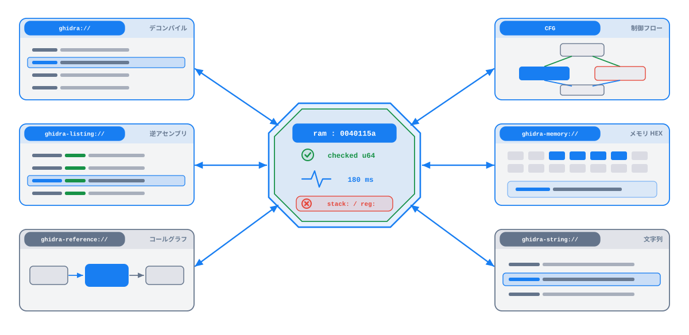

# Neovim ガイド

`editors/nvim/` にある Neovim プラグインは、**Neovim 0.10 以上** 向けに設計されたネイティブ Lua クライアントです。外部依存なしで LSP バッファ管理、フローティング検索ピッカー、5 種類コメントエディタ、関数／変数フォーム、仮想アセンブリ・Hex・CFG・コールグラフ・JSONC データ型バッファを提供します。

## インストールと設定

`server_path` と `mcp_command` が既定値のままで `PATH` に見つからない場合、プラグインは `npm` を通じて `@ghidra-lsp/cli` と `@ghidra-mcp/cli` を共有管理ディレクトリ（Linux/macOS は `~/.local/share/ghidra-lsp/bin`、Windows は `%LOCALAPPDATA%\ghidra-lsp\bin`、VS Code 拡張と共有）へ自動インストールします。`:GhidraInstall` でいつでも手動インストール・更新できます。

プラグイン概要は [editors/nvim/README.md](../../editors/nvim/README.md) も参照してください。

### `lazy.nvim` での設定例

```lua
{
    'ghidra-lsp',
    dir = '/path/to/ghidra-lsp/editors/nvim',
    config = function()
        require('ghidra-lsp').setup({
            server_path = 'ghidra-lsp',
            mcp_command = 'ghidra-mcp',
            mcp_args = {},
            request_timeout_ms = 35000,
            template_arguments = 'omit',
            auto_attach = true,
            auto_start = false,
        })
    end,
}
```

### `setup(opts)` オプション一覧

`editors/nvim/lua/ghidra-lsp/client.lua` および `init.lua` でサポートされている設定オプションは次のとおりです。

| オプション | デフォルト | 説明 |
| --- | --- | --- |
| `server_path` | `'ghidra-lsp'` | `ghidra-lsp` バイナリの実行ファイル名またはフルパス |
| `mcp_command` | `nil` | `ghidra-mcp` のコマンドパス（`nil` の場合はサーバー側の既定値 `'ghidra-mcp'`） |
| `mcp_args` | `{}` | `ghidra-mcp` へ渡す追加引数の文字列配列 |
| `request_timeout_ms` | `35000` | バックエンド MCP 呼び出しのタイムアウト（ミリ秒） |
| `template_arguments` | `'omit'` | `'omit'` で C++ テンプレート引数を `<…>` 省略、`'show'` で完全表示 |
| `auto_attach` | `true` | 仮想バッファへ LSP クライアントを自動アタッチするかどうか |
| `auto_start` | `false` | `setup()` 呼び出し時に即座に `ghidra-lsp` クライアントを起動するかどうか |
| `auto_install` | `true` | 既定の `ghidra-lsp` / `ghidra-mcp` が見つからない場合に `npm` で自動インストールするかどうか |

導入後は `:checkhealth ghidra-lsp` で Neovim バージョン（`>= 0.10`）、`npm`、共有バイナリディレクトリ、`ghidra-lsp` / `ghidra-mcp` の解決元（`managed`/`path`/`custom`）、LSP クライアント状態、および選択中セッションを診断できます。


## 全 29 個の `:Ghidra*` ユーザーコマンド

`editors/nvim/plugin/ghidra-lsp.lua` に登録されている全 29 個のコマンドは次のとおりです。

| コマンド | 引数 | 動作 |
| --- | --- | --- |
| `:GhidraInstall` | `[lsp\|mcp]` | `npm` 経由で `ghidra-lsp` と `ghidra-mcp` バイナリをインストールまたは更新します |
| `:GhidraOpenBinary` | `[path]` | バイナリファイルを開きます（解析済みなら無言で復元、未解析なら解析実行を確認） |
| `:GhidraSelectSession` | `[md5]` | 開いているまたは保存済みの Ghidra セッションを選択・アクティブ化します |
| `:GhidraCloseSession` | `[md5]` | 指定または現在の Ghidra セッションを閉じます（未保存編集や保留中リネームがある場合は拒否） |
| `:GhidraCheckpoints` | `[md5]` | 保存済みプロジェクトチェックポイントをピッカーで参照・復元します |
| `:GhidraRestoreCheckpoint` | `[id\|name]` | 最新または `<Tab>` 補完で選択したチェックポイントを復元して全バッファを更新します |
| `:GhidraResetSession` | `[analyze\|noanalyze]` | アクティブなセッションをクリーンな再インポート状態へリセットして全バッファを更新します |
| `:GhidraReanalyze` | なし | アクティブな Ghidra プログラムの再解析を実行します |
| `:GhidraOpenFunction` | `[entry\|name]` | エントリアドレスまたは関数名（`<Tab>` 補完付き）で関数を開きます |
| `:GhidraFunctions` | なし | 検索可能なフローティングピッカーで関数一覧を参照して開きます |
| `:GhidraSymbols` | なし | プログラム全体のシンボルをピッカーで検索してジャンプします |
| `:GhidraTypes` | なし | プログラム内のデータ型をピッカーで検索して開きます |
| `:GhidraStrings` | なし | 定義済み文字列をピッカーで検索し、`ghidra-string://` バッファで開きます |
| `:GhidraGoto` | `[address]` | アドレスへジャンプします（関数内なら逆コンパイル行へ、関数外なら Listing へフォールバック） |
| `:GhidraListing` | `[address]` | プログラムアセンブリリスティング（`ghidra-listing://`）を開きます |
| `:GhidraMemory` | `[address]` | ライブ Data Inspector 付き Hex／メモリビューア（`ghidra-memory://`）を開きます |
| `:GhidraHex` | `[address]` | `:GhidraMemory` のエイリアス |
| `:GhidraComment` | `[address]` | カーソル位置または指定アドレスの 5 種コメントフローティングエディタを開きます |
| `:GhidraEditFunction` | なし | 現在の関数シグネチャ・呼び出し規約・パラメータ編集フォームを開きます |
| `:GhidraEditVariables` | なし | 現在の関数のパラメータおよびローカル変数の名前・型編集ピッカーを開きます |
| `:GhidraControlFlow` | なし | 現在の関数の基本ブロック制御フローグラフ（`ghidra-cfg://`）を開きます |
| `:GhidraCallGraph` | `[entry\|address]` | 指定または現在関数の境界付きコールグラフ（`ghidra-callgraph://`）を開きます |
| `:GhidraEditType` | `[path]` | 指定データ型の編集可能 `.ghidra-type` JSONC バッファ（`ghidra-type://`）を開きます |
| `:GhidraParseC` | `[category]` | C ヘッダ宣言用のフローティングバッファ（`ghidra-parse-c://`）を開き、`:w` で `data_type.parse_c` により一括取り込みます |
| `:GhidraRefresh` | なし | 現在の Ghidra 仮想バッファ（C 擬似コード、型、Listing、Hex、グラフ）を再取得・更新します |
| `:GhidraDiscardRename` | なし | 保留中のスコープ付きシンボルリネームプレビューを破棄します |
| `:GhidraOrigin` | なし | 保留中リネームを開始したオリジンバッファへジャンプします |
| `:GhidraOverview` | なし | プログラム概要スナップショット（`ghidra-overview://<md5>`）を表示します |
| `:GhidraCallHierarchy` | なし | カーソル位置の関数コール階層を表示します |

## 仮想バッファのキーマップ

### `ghidra://` 逆コンパイル・スナップショットバッファ

| キー | 対象バッファ | 動作 |
| --- | --- | --- |
| `K` | すべて | LSP ホバー情報（型・シグネチャ・ストレージ・完全名） |
| `<C-k>` | すべて | シグネチャヘルプ |
| `gd` / `gD` / `gi` / `gy` | すべて | 定義 / 宣言 / 実装 / 型定義へジャンプ |
| `gr` / `gO` | すべて | 相互参照検索（Quickfix 表示）/ ドキュメントシンボル一覧 |
| `<F2>` / `<leader>rn` | すべて | スコープ付きリネームプレビュー開始（`:w` でオリジン保存、`:GhidraDiscardRename` で破棄） |
| `<leader>ca` | すべて | Ghidra コードアクション（コメント・関数・変数編集、型検査、各ビュー起動） |
| `<leader>gt` | すべて | カーソル位置の型を `.ghidra-type` JSONC として編集（またはピッカーで型選択） |
| `<leader>gl` | 関数バッファのみ | カーソル位置のアドレスで Program Listing を開く |
| `<leader>gm` | 関数バッファのみ | カーソル位置のアドレスで Hex / Memory ビューアを開く |
| `<leader>gc` | 関数バッファのみ | カーソル位置のコードユニットに対する 5 種コメントエディタを開く |
| `<leader>go` | 関数バッファのみ | アドレス指定ジャンプ（`:GhidraGoto`） |
| `<leader>gh` | 関数バッファのみ | コール階層表示（`:GhidraCallHierarchy`） |
| `q` | スナップショットのみ | 分割ウィンドウが複数ある場合にスナップショットを閉じる |

### 各種解析ビューバッファのキーマップ



#### Program Listing（`ghidra-listing://`）

- `<CR>` / `d`: カーソル行のアドレスを逆コンパイラで表示（`:GhidraGoto` 相当）
- `m`: カーソル行のアドレスを Hex / Memory ビューアで開く
- `c`: カーソル行のアドレスに対する 5 種コメントエディタを開く
- `gr` / `x`: 当該アドレスへの被参照（Xrefs）を Quickfix リストへ表示
- `g`: アドレス入力プロンプトからジャンプ
- `]p` / `[p`: 次／前のページウィンドウを読み込み
- `]b` / `[b`: 次／前のメモリブロックへ移動
- `r` / `q`: リフレッシュ / 分割ウィンドウを閉じる

#### Hex / Memory Viewer（`ghidra-memory://`）

カーソル移動（`CursorMoved`）のたびに `ghidra.inspectBytes` を同期呼び出しし、バッファ上部 2 行の **Data Inspector**（`uint8`、`int8`、`ASCII`、`UTF-8`、`uint16`、`uint32`、`int32`、`uint64`、`Pointer`）と Hex／ASCII 列ハイライトをリアルタイム更新します。

- `<CR>` / `l`: 選択バイトアドレスの Program Listing を開く
- `d`: 選択バイトアドレスの逆コンパイル位置を開く
- `e`: エンディアンを `little` / `big` 間で切り替え
- `]p` / `[p`: 次／前のメモリチャンクへ移動
- `g` / `r` / `q`: アドレスジャンプ / リフレッシュ / 閉じる

#### Control Flow Graph（`ghidra-cfg://`）& Call Graph（`ghidra-callgraph://`）

- **CFG バッファ**: `<CR>`（逆コンパイラで表示）、`l`（Listing を開く）、`r`（更新）、`q`（閉じる）
- **Call Graph バッファ**: `<CR>`（カーソル行の関数を開く）、`l`（Listing を開く）、`+` / `-`（Callers・Callees の探索深さを `1`〜`3` の範囲で増減）、`r`（更新）、`q`（閉じる）

#### Defined Strings（`ghidra-string://`）& Data Types（`ghidra-type://`）

- **String バッファ**: `gr` / `x`（文字列への Xrefs を Quickfix 表示）、`<leader>gl`（Listing）、`<leader>gm`（Memory）、`q`（閉じる）
- **Type バッファ（JSONC）**:
  - 編集中の `TextChanged` / `InsertLeave` イベントで `ghidra.validateTypeDocument` が自動実行され、Neovim の診断（`vim.diagnostic`）としてエラー箇所を直接ハイライトします。
  - `:w` で `ghidra.saveTypeDocument` を実行して競合確認・永続化・正規化再読込を行います。
  - `<leader>gr` でサーバー上の最新定義を再読み込みし、読み取り専用型では `q` でウィンドウを閉じられます。

## フローティング編集 UI とテーマ連動ハイライト

### テーマ連動ハイライトグループ（`GhidraFloat*` / `GhidraTab*`）

`require('ghidra-lsp').setup()` は起動時および `ColorScheme` 変更時（`GhidraLspHighlights` 自動コマンドグループ）に次のハイライトグループを `default = true` で定義するため、カラースキームに自動追従しつつ個別の上書きも可能です。

| ハイライトグループ | デフォルトリンク先 | 用途 |
| --- | --- | --- |
| `GhidraFloatBorder` | `FloatBorder` | フローティングウィンドウの枠線 |
| `GhidraFloatTitle` | `Title` | フローティングウィンドウのタイトル文字 |
| `GhidraFloatFooter` | `Comment` | フッターのヒント文字と非アクティブ空タブ |
| `GhidraTabActive` | `PmenuSel` | コメントエディタで現在選択中の種別ピル |
| `GhidraTabDirty` | `DiagnosticWarn` | 未保存インジケータ（`*`）と警告状態ノート |
| `GhidraTabFilled` | `DiagnosticInfo` | コメントが入力済みの非アクティブ種別ピル・`saved` 表示 |
| `GhidraStatusAccent` | `Special` | 区切り線（`│`）やキーヒントの強調表示 |

フローティングピッカー（`ui.pick`）にも上記 `winhighlight`、件数表示付きタイトルチャンク、およびフッター操作ヒント（`<CR> select · <C-n>/<C-p> move · <Esc>/q close`）が適用されます。

### 5 種類コメントエディタ（`:GhidraComment` / `<leader>gc`）

`editors/nvim/lua/ghidra-lsp/edit.lua` が `ghidra-comment://<md5>/<address>` のフローティングウィンドウを開きます。

- タイトル枠（`Ghidra Comments · <address> [PRE*]`）とフッター枠（`[PLATE] [PRE*] [EOL] [POST] [REPEATABLE (ext)] │ :w/<C-s> save · <Tab> kind · q close`）がハイライトチャンクで描画され、入力やタブ切替・保存に応じてリアルタイム更新されます（`nvim-0.9` 以上でタイトル、`nvim-0.10` 以上でフッターを表示）。
- 未保存変更がある種別には `*`（`GhidraTabDirty`）、既存コメントがある種別には選択外でも `GhidraTabFilled` が付きます。
- `<Tab>` / `<S-Tab>`: 5 種類のコメント区分を順番に切り替え（ドラフトは種類ごとに保持）
- `<C-s>` または `:w`: 選択中のコメント区分を `ghidra.saveComment` で即座に保存（テキストを空にして保存するとそのコメントを削除）
- `q` または `<Esc>`: エディタを閉じる（未保存ドラフトがある場合は破棄確認ダイアログを表示）
- ノーマルモードの `d` キーは上書きせず保持しているため、`dd`・`dw`・`d$` など Vim 標準の削除オペレータをそのまま使えます。

### 関数シグネチャ・変数編集（`:GhidraEditFunction` / `:GhidraEditVariables`）

- `:GhidraEditFunction` は `ghidra-edit-fn://<md5>/<entry>` の YAML 形式フォームを `GhidraFloat*` チャンク枠（フッター `:w save to Ghidra │ q close`）付きで開き、`name`、`return_type`、`calling_convention`、`varargs`、`noreturn`、`inline`、`comment`、および `param.N: <type> | <name>` を編集して `:w` で原子的に一括保存します。
- `:GhidraEditVariables` は対象関数のパラメータとローカル変数をピッカーで選択し、新しい名前と新しいデータ型を対話入力して `ghidra.saveVariables` を実行します。

次の章: [編集と安全性](editing-and-safety.md)。
