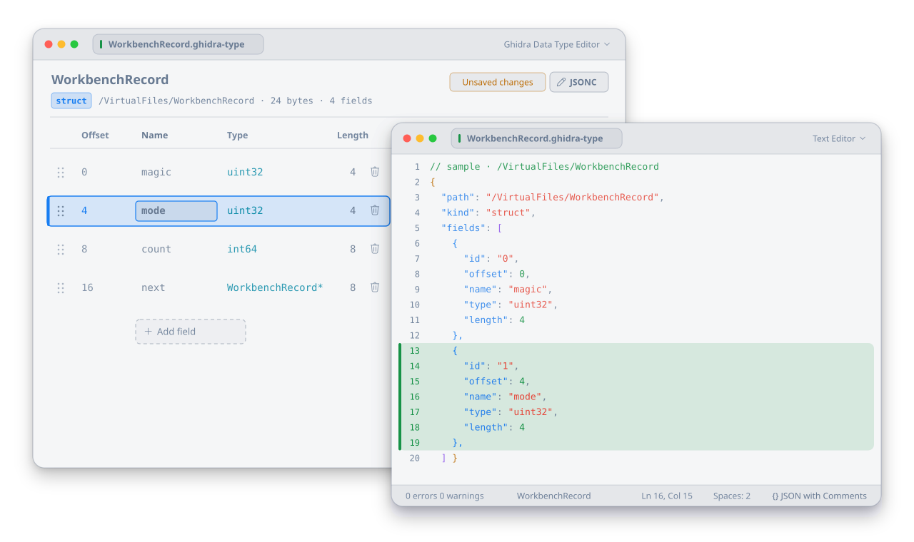
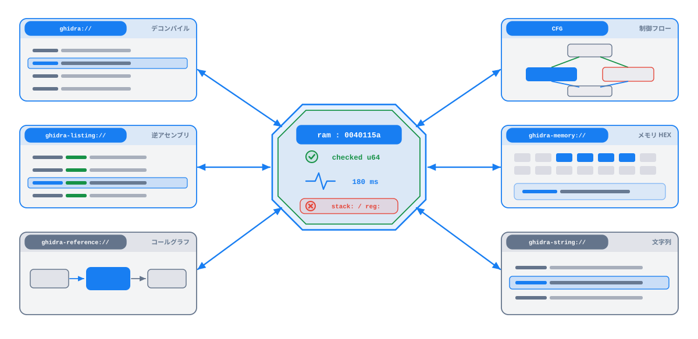
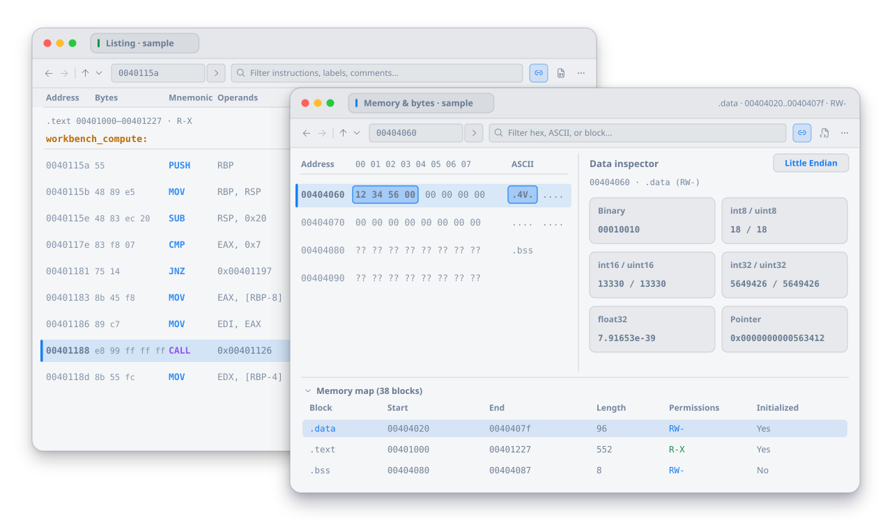
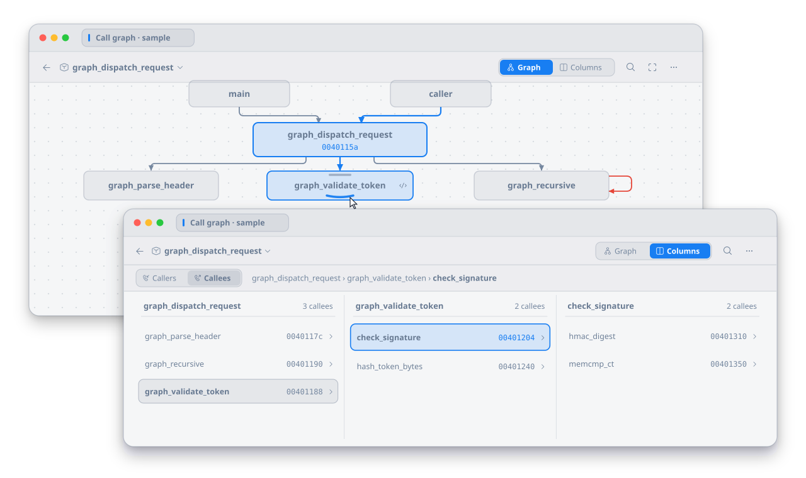

# VS Code ガイド

`ghidra-lsp` の Visual Studio Code 拡張機能（`editors/vscode/`、VS Code `^1.96.0` 対応）は、逆コンパイル済み C 擬似コードの横でアセンブリリスティング、Hex メモリビューア、制御フローグラフ、コールグラフ／カラム、データ型エディタ、プログラムブラウザを統合的に扱えるリバースエンジニアリングワークベンチを提供します。

## インストールと VSIX パッケージ

[クイックスタート](getting-started.md) の手順で拡張機能をコンパイルして `.vsix` を生成します。

```sh
npm --prefix editors/vscode install
npm --prefix editors/vscode run check
npm --prefix editors/vscode run package
```

生成された `.vsix` は VS Code の **Extensions: Install from VSIX...** または CLI からインストールできます。

```sh
code --install-extension editors/vscode/ghidra-lsp-<version>.vsix
```

拡張機能自体の概要は [editors/vscode/README.md](../../editors/vscode/README.md) にも記載されています。

## サイドバービュー（Program Browser）

アクティビティバーの **Ghidra** コンテナ（`ghidra`）には、次の 4 つのツリービューが配置されています。

| ビュー ID | タイトル | 初期状態 | 役割 |
| --- | --- | --- | --- |
| `ghidra.sessions` | Sessions | 折りたたみ | アクティブセッション、進行中の解析タスク（`AnalysisTracker`）、最近開いたプログラムの管理 |
| `ghidra.symbols` | Symbols | 表示 | C++ 名前空間階層で整理された関数・グローバルシンボル一覧と Program Overview 等のツールバー操作 |
| `ghidra.strings` | Strings | 折りたたみ | デフォルトアドレス空間から抽出された定義済み文字列一覧（クリックで `ghidra-string://` を表示） |
| `ghidra.types` | Data Types | 表示 | カテゴリ別のデータ型ツリー。型の作成（`ghidraLsp.createType`）・編集（`ghidraLsp.editType`）・削除（`ghidraLsp.deleteType`）に対応 |

ファイルエクスプローラ上の任意の実行ファイルを右クリックして **Ghidra: Open Binary** を選択するか、各ビューの Welcome 画面からバイナリを開くことができます。

## 逆コンパイルエディタとカスタムエディタ

### 読み取り専用仮想 C バッファ（`ghidra://`）

関数を開くと `ghidra://<md5>/function/<entry>` が `ghidra-decompiled` 言語モードで開きます。`ghidra-lsp` サーバー自体は 6 種類の **CodeLens** を返しますが、VS Code 拡張のミドルウェア（`editors/vscode/src/extension.ts`）が VS Code 標準の References / Call Hierarchy と重複する `Callers`・`Callees`・`References` を除外するため、エディタ上部には次の 3 種類の CodeLens が表示されます。

- **Listing** / **Call Graph** / **Control Flow**

また、インレイヒントとしてローカル変数のストレージ位置（例: `: stack -0x18`、`: RDI`）と関数呼び出し先アドレス（例: `[ram:004012a0]`）が自動表示されます。

### 2 つのカスタムエディタ（`customEditors`）

`editors/vscode/package.json` には 2 つのカスタムエディタが登録されています（`ghidra.analysisControlFlow` は `priority: "option"`、`ghidra.dataTypeEditor` は `priority: "default"`）。通常のテキストタブとグラフィカル表示は **Ghidra: Switch Analysis View…**（`ghidraLsp.analysisView`）、ヘッダの **`JSONC`** ボタン、または **Reopen Editor With…** で切り替えられます。

1. **Ghidra Control Flow（`ghidra.analysisControlFlow`）**
   - 対象: `ghidra-listing:/listing/*`
   - `elkjs` の階層化レイアウトと角丸の直交エッジルーティング（`roundedOrthogonalPath`）により、角丸カード（`rx="8"` / ヘッダ `rx="7"`）の基本ブロック、右寄せの `Entry` バッジ、アセンブリ命令、条件分岐（`taken`）、フォールスルー（`fallthrough`）、逆方向ループエッジ、および右下のミニマップ（`Overview`）とズームコントロールを描画します。
   - 基本ブロックの選択・ダブルクリック（または `Enter`）で、対になっている逆コンパイル画面の該当ソース式がハイライト／スクロールされます。


2. **Ghidra Data Type Editor（`ghidra.dataTypeEditor`）**
   - 対象: `ghidra-type:/**/*`
   - `.ghidra-type` JSONC ドキュメントと**同一のテキストバッファとドラフトを共有**するグラフィカルフォームです。
   - 上部ヘッダに型種別バッジ（`struct` / `union` / `enum` / `function`）・型パス・バイト数・メンバ数、未保存ステータス、および隣のタブに `.ghidra-type` テキストエディタを開く **`JSONC`** ボタンを備えています（JSONC 本文へ `"$schema"` は追加しません）。
   - 構造体フィールドのドラッグ移動・矢印キー並び替え、ソート、フォーカス行ハイライト、点線枠の `+ Add field` スロットによる行追加／削除、列挙体値、関数シグネチャパラメータ編集を行いつつ、`ghidra-type` 診断結果（バリデーションエラー）をフォーム上部にリアルタイム表示します。
   - 組み込み型や `typedef` などは `.ghidra-type-readonly` としてスキーマ検証を除外したうえで、読み取り専用理由をインラインバナーに明示して安全に表示されます。クライアントミドルウェアにより、型定義ジャンプやワークスペースシンボルも既定でこのエディタへルーティングされます（メモリ上のグローバルシンボルは `ghidra-listing://` 行へ、データアドレスリンクは `ghidraLsp.goToAddress` へ変換されます）。



## 解析ビューと双方向カーソル同期

**Ghidra: Open Analysis Views**（`ghidraLsp.openViews`）を実行すると、逆コンパイルエディタ（`ghidra://`）の隣に `ghidra-listing://` タブが開き、タイトルバーメニューから同じタブの表示モードを **Listing** / **Bytes** / **Control Flow** に切り替えられます。



`ghidraLsp.views.syncCursor` が `true`（デフォルト）の場合、同一プログラムに対する以下のビュー間でカーソル選択位置が双方向に同期します。

- **Program Listing**（`ghidra.listing` Webview および `ghidra-listing://` テキスト）:
  - 連続する未定義バイト列（8 バイト以上）の自動折りたたみ表示。
  - メモリブロック間の移動、ウィンドウ前後ページング、命令・ラベル・相互参照数の表示。
- **Memory and Bytes (Hex)**（`ghidra.memory` Webview および `ghidra-memory://` テキスト）:
  - 8 バイト／16 バイト幅の切り替え、`little` / `big` エンディアン切り替え、折りたたみ可能な `Memory map`（メモリブロック一覧）を備えます。
  - 選択バイトに連動してサーバー（`ghidra.inspectBytes`）がデコードした 2 カラムカードグリッド形式の **Data Inspector**（`Binary`、`int8 / uint8`、`int16 / uint16`、`int32 / uint32`、`int64 / uint64`、`float32`、`float64`、`Pointer`、`ASCII`、`UTF-8`）を表示し、インスペクタヘッダの **`Little Endian` / `Big Endian`** ピルをクリックすると多バイト値をライブ再デコードできます。



## コールグラフと Miller カラムナビゲーション

**Ghidra: Call Graph**（`ghidraLsp.showCallGraph`）を開くと、選択中の関数をルートにして上に **Callers（呼び出し元）**、下に **Callees（呼び出し先）** が階層配置されます。トップバー（`.call-topbar`）の検索アイコン手前にある **`Graph` / `Columns`** セグメントスイッチで表示モードを切り替えられます。

- **Graph モード**: コンパクトな角丸ノードカード（ルートカード内には `displayAddress(node.entry)` サブタイトルを表示）と角丸直交エッジで構成されます。静止時はカードが中央揃えですっきりと保たれ、任意のノードにホバーまたはフォーカスしたときのみ、上側内側縁（`callers`）と下側内側縁（`callees`）に展開・折りたたみ方向へしなやかにたわむミニマルな水平グラバーバーと右側のデコンパイルボタンが表示され、発見済みのすべてのノードで双方向の対話的な展開・折りたたみ（`expansion.callers` / `expansion.callees`）を行えます。サーバー側の上限は 80 ノード／240 エッジ／40 クエリです。
- **Call Columns モード**: 左から右へ連続して呼び出しパスを掘り下げる Miller カラムブラウザです。**`Callers` / `Callees`** ラベル付き切替ボタンとパンくずトレイルを備え、各行にはシェブロン手前に呼び出し箇所／エントリの短縮アドレスヒントを表示します。1 パス最大 20 階層・各カラム最大 200 関数を表示し、再帰サイクルを検出すると循環先への戻りバッジ（`cycleAt`）を表示します。



## 5 種類コメントスレッドとリネーム UI

- **横並びタブ付きコメントスレッドと 5 種類コメントフォーム**: 擬似コード上のトークンで `Ctrl+.`（macOS は `Cmd+.`）から **Edit comments at …** を選ぶと、ネイティブ VS Code コメントスレッド（`CommentThread`）が開き、上部の **Comment type** 行に並んだ `PLATE`、`PRE`、`EOL`、`POST`、`REPEATABLE (ext)` の 5 つのバッジタブで区分を切り替えてインライン編集できます。一方、**Symbol Inspector**、**Function Inspector**、**Program Listing** ツールバー、グローバルシンボル、または閉じた関数から **Edit comment** を実行した場合は、擬似コードタブを開かずに `ghidra.commentsAt` / `ghidra.saveComment` 連携の 5 種類コメントフォームが開きます（未保存ドラフト破棄時はいずれも確認ダイアログを表示します）。
- **リネームバッジとステータスバー**: `F2` でリネームをプレビューすると、影響を受けるすべての開いた `ghidra://` タブに `M` バッジが付き、ステータスバーに保留中のリネーム件数と元の関数へ戻るコマンド（`ghidraLsp.showPendingRename`）が表示されます。


> [!TIP]
> リネームやデータ型保存を常に手動確認で確定したい場合は、VS Code 設定で `"files.autoSave": "off"` および `"files.refactoring.autoSave": false` に設定してください。

## 拡張機能設定リファレンス（`ghidraLsp.*`）

`ghidraLsp.serverPath`（`"ghidra-lsp"`）と `ghidraLsp.mcpCommand`（`"ghidra-mcp"`）が既定値のままで `PATH` 上に見つからない場合、拡張機能は `npm` を通じて `@ghidra-lsp/cli` と `@ghidra-mcp/cli` を共有管理ディレクトリ（Linux/macOS は `~/.local/share/ghidra-lsp/bin`、Windows は `%LOCALAPPDATA%\ghidra-lsp\bin`）へ自動インストールします。VS Code のユーザーまたはワークスペース `settings.json` で設定します。

```json
{
  "ghidraLsp.autoInstall": true,
  "ghidraLsp.serverPath": "ghidra-lsp",
  "ghidraLsp.mcpCommand": "ghidra-mcp",
  "ghidraLsp.mcpArgs": [],
  "ghidraLsp.requestTimeoutMs": 35000,
  "ghidraLsp.liveRefreshIntervalMs": 2000,
  "ghidraLsp.templateArguments": "omit",
  "ghidraLsp.views.syncCursor": true,
  "files.autoSave": "off",
  "files.refactoring.autoSave": false
}
```

`editors/vscode/package.json` で定義されている全 8 項目の設定キーです。

| 設定キー | 型 | デフォルト | 説明 |
| --- | --- | --- | --- |
| `ghidraLsp.autoInstall` | `boolean` | `true` | 既定の `ghidra-lsp` / `ghidra-mcp` が見つからない場合に `npm` 経由で共有バイナリディレクトリへ自動インストールします |
| `ghidraLsp.serverPath` | `string` | `"ghidra-lsp"` | `ghidra-lsp` バイナリのパス。変更後は拡張機能の再起動が必要です |
| `ghidraLsp.mcpCommand` | `string` | `"ghidra-mcp"` | `ghidra-mcp` 実行ファイルのコマンド名またはパス |
| `ghidraLsp.mcpArgs` | `string[]` | `[]` | `ghidra-mcp` 子プロセスへ渡す追加コマンドライン引数 |
| `ghidraLsp.requestTimeoutMs` | `number` | `35000` | バックエンド呼び出しのタイムアウト（ミリ秒、100〜300000） |
| `ghidraLsp.liveRefreshIntervalMs` | `number` | `2000` | 表示中かつ未変更の関数ビューを Ghidra から自動再取得する間隔（ms）。`0` で無効化 |
| `ghidraLsp.templateArguments` | `"omit"` \| `"show"` | `"omit"` | `"omit"` は C++ テンプレート引数を `<…>` へ省略表示、`"show"` は完全展開 |
| `ghidraLsp.views.syncCursor` | `boolean` | `true` | Program Listing、Hex View、Control Flow、Decompiler タブ間のカーソル選択同期を有効化 |

## キーバインドと主要コマンド

### デフォルトキーバインド

| キー（Win/Linux） | キー（macOS） | コマンド ID | 条件（`when`） |
| --- | --- | --- | --- |
| `Ctrl+.` | `Cmd+.` | `ghidraLsp.codeActions` | `resourceScheme == ghidra && editorTextFocus && editorLangId == ghidra-decompiled && !renameInputVisible` |
| `F2` | `F2` | `ghidraLsp.renameSymbol` | `resourceScheme == ghidra && editorTextFocus && !renameInputVisible` |
| `Ctrl+S` | `Cmd+S` | `ghidraLsp.saveRename` | `resourceScheme == ghidra && editorTextFocus && !renameInputVisible` |

### 主要コマンド一覧（全コマンドは `ghidraLsp.*`）

| カテゴリ | コマンド ID とタイトル |
| --- | --- |
| セッション・解析 | `ghidraLsp.openBinary`（Open Binary）、`ghidraLsp.openRecent`（Open Recent Program）、`ghidraLsp.selectSession`（Select Session）、`ghidraLsp.selectSessionItem`（Switch to Session）、`ghidraLsp.openRecentItem`（Reopen Session）、`ghidraLsp.refreshSessions`（Refresh Sessions）、`ghidraLsp.closeSession`（Close Program）、`ghidraLsp.reanalyze`（Reanalyze Program）、`ghidraLsp.cancelAnalysis`（Stop Waiting for Analysis）、`ghidraLsp.programOverview`（Program Overview）、`ghidraLsp.installBinaries`（Install or Update Binaries） |
| ナビゲーション・詳細 | `ghidraLsp.openFunction`（Open Function）、`ghidraLsp.goToAddress`（Go to Address）、`ghidraLsp.demangle`（Demangle C++ Symbols）、`ghidraLsp.refresh`（Refresh Documents）、`ghidraLsp.refreshBrowser`（Refresh Program Browser）、`ghidraLsp.refreshStrings`（Refresh Strings）、`ghidraLsp.functionDetails`（Function Details）、`ghidraLsp.inspectType`（Inspect Type at Cursor）、`ghidraLsp.browseSymbol`（Show Symbol Details） |
| リネーム・編集 | `ghidraLsp.renameSymbol`（Rename Symbol）、`ghidraLsp.saveRename`（Submit Pending Rename）、`ghidraLsp.saveAllRenames`（Submit All Pending Renames）、`ghidraLsp.showPendingRename`（Show Pending Rename）、`ghidraLsp.discardRename`（Discard Pending Rename）、`ghidraLsp.codeActions`（Code Actions…）、`ghidraLsp.editComment`（Edit Comment）、`ghidraLsp.editCommentText` / `ghidraLsp.selectCommentKind`（Switch Comment Kind） / `ghidraLsp.saveComment` / `ghidraLsp.cancelCommentEdit` / `ghidraLsp.closeCommentEditor`（インラインコメント操作）、`ghidraLsp.editFunction`（Edit Function Signature）、`ghidraLsp.editVariables`（Edit Variables and Parameters）、`ghidraLsp.editSymbol`（Edit Global Symbol） |
| データ型 | `ghidraLsp.createType`（Create Data Type）、`ghidraLsp.editType`（Edit Data Type）、`ghidraLsp.deleteType`（Delete Data Type）、`ghidraLsp.applyType`（Apply Data Type）、`ghidraLsp.typeDetails`（Data Type Details）、`ghidraLsp.compareType`（Compare Data Type with Ghidra）、`ghidraLsp.reloadType`（Reload Data Type from Ghidra） |
| ビュー・グラフ | `ghidraLsp.openViews`（Open Analysis Views）、`ghidraLsp.analysisView`（Switch Analysis View…）、`ghidraLsp.showListing`（Disassembly Listing）、`ghidraLsp.browseListing`（Program Listing）、`ghidraLsp.showMemory`（Memory and Bytes (Hex)）、`ghidraLsp.showStrings`（Strings）、`ghidraLsp.showImports`（Imports）、`ghidraLsp.showExports`（Exports）、`ghidraLsp.showControlFlow`（Control Flow Graph）、`ghidraLsp.showCallGraph`（Call Graph）、`ghidraLsp.showCallHierarchy`（Show Call Hierarchy）、`ghidraLsp.showCallers`（Callers）、`ghidraLsp.showCallees`（Callees）、`ghidraLsp.showReferences`（Address References）、`ghidraLsp.showAddressReferences`（Binary Address References） |
| Listing ツールバー | `ghidraLsp.listingFunction`（Open Containing Function）、`ghidraLsp.listingReferences`（References at Address）、`ghidraLsp.listingBytes`（Switch to Bytes）、`ghidraLsp.bytesListing`（Switch to Listing）、`ghidraLsp.listingCopyAddress`（Copy Address）、`ghidraLsp.listingBrowse`（Open in Program Listing）、`ghidraLsp.listingRefresh`（Refresh Listing） |

コメント編集やリネームの安全機構について詳しくは [編集と安全性](editing-and-safety.md) をご覧ください。

次の章: [Neovim ガイド](neovim-guide.md)。
