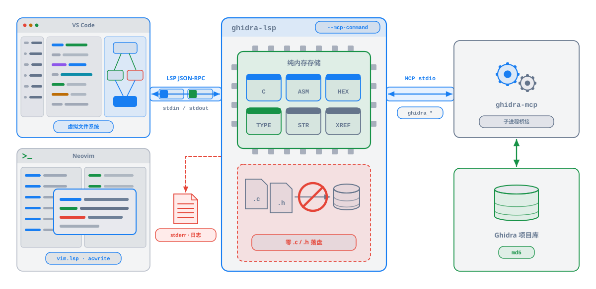
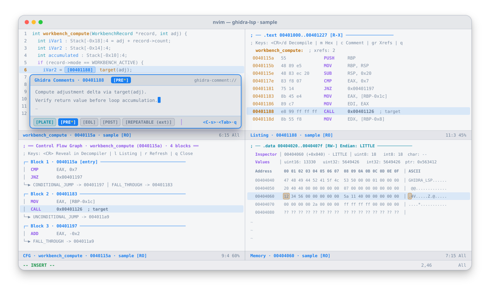

# ghidra-lsp


[](../../README.md)

[](../ja/README.md)

通过 `ghidra-mcp` 将 Ghidra 实时反编译、汇编清单、内存视图、控制流图、调用图与受控符号编辑能力以 Language Server Protocol (LSP) 接入 Visual Studio Code 与 Neovim。

---

## 核心特性

- **纯内存虚拟文档**：所有反编译伪代码（`ghidra://`）、汇编清单（`ghidra-listing://`）、十六进制内存窗口（`ghidra-memory://`）、JSONC 数据类型（`ghidra-type://`）、已定义字符串（`ghidra-string://`）与交叉引用预览（`ghidra-reference://`）均严格保存在内存中，绝不向磁盘写入任何 `.c` 或 `.h` 文件。
- **单次反编译预算**：每次打开函数仅通过单次 `decompilation.get`（`format: "document"`、`include_comments: true`）同时获取 GUI 文本行、Token 对齐、光标地址映射与全部 5 类注释（`PLATE`、`PRE`、`EOL`、`POST`、`REPEATABLE`）。
- **受控持久化与安全重命名**：反编译 C 缓冲区默认只读；通过 `<F2>` 发起作用域重命名预览，仅在保存原始源视图（Origin Save）时原子写入 Ghidra 并持久保存项目；写操作超时后会在重试前重新核验后端真实状态。
- **JSONC 与图形化双模式类型编辑器**：`ghidra-type://` 虚拟文档与 VS Code 图形化 **Ghidra Data Type Editor** 共享同一草稿，提供模式校验、冲突检测与安全整数边界保护。
- **双端深度集成**：提供官方 [VS Code 扩展](../../editors/vscode/README.md) 与原生 [Neovim 插件](../../editors/nvim/README.md)，支持双向光标同步、控制流图（CFG）、支持横向 5 类注释徽章页签的行内注释、悬停内沿抓取条交互式调用图（Call Graph）与米勒分栏（Call Columns）导航。

---

## 系统架构概览



- **LSP 传输边界**：`ghidra-lsp` 通过 `stdin`/`stdout` 收发封装后的 LSP JSON-RPC 消息，所有日志仅输出至 `stderr`。
- **MCP 子进程传输**：`ghidra-lsp` 按需以子进程方式启动 `ghidra-mcp`，经由 Model Context Protocol 标准输入输出调用 `ghidra_*` 工具，不与 `ghidra-mcp` 共享源码或工作区依赖。
- **身份与编码不变量**：在 URI 与 RPC 载荷中完整保留 32 位小写 `md5`、规范 `space:offset` 地址、符号 ID 与原始修饰名（Mangled Name）；仅在界面显示层剥离 `ram:` 前缀或折叠外层 C++ 模板参数为 `<…>`。LSP 位置统一采用 UTF-16 码元计算，地址运算统一使用带溢出检查的 `u64` 算术。

---

## 工作台界面预览

### VS Code 多面板协同工作台

在 Visual Studio Code 中，反编译 C 伪代码（`ghidra://`）可以与 **Control Flow** 自定义编辑器（`ghidra.analysisControlFlow`）、**Program Browser** 侧边栏树视图及行内 5 类注释组件协同工作，点击任意基本块或地址都会同步定位。


### Neovim 原生多窗口分析工作台

在 Neovim 中，`:Ghidra*` 命令可打开汇编清单（`ghidra-listing://`）、带实时数据检视器的十六进制内存视图（`ghidra-memory://`）、控制流图（`ghidra-cfg://`）、调用图（`ghidra-callgraph://`）以及 5 标签浮动注释编辑器，并原生支持 `K`、`<C-k>`、`gd`、`gr`、`gO`、`<F2>` 与 `<leader>ca`。



---

## 快速安装与构建

### 使用 npm 安装

若系统已安装 Node.js 18 或更高版本，可通过 npm 直接安装对应平台的预编译可执行文件：

```sh
npm install --global @ghidra-lsp/cli
ghidra-lsp --version
```

或使用 `npx` 直接运行：

```sh
npx @ghidra-lsp/cli --version
```

npm 会根据当前系统自动安装一个匹配的平台包（如 `@ghidra-lsp/linux-x64`）。平台包通过 `optionalDependencies` 分发，因此请勿使用 `--omit=optional`。Linux 平台包依赖 glibc；在 Alpine 等 musl 系统上请从源代码构建。

### 从源代码构建

使用 Cargo 构建发布版二进制文件（要求 Rust `1.88` 及以上）：

```sh
cargo build --locked --release
```

在提交更改前运行完整仓库合规检查与 CI 流水线：

```sh
cargo xtask ci
```

通过 [CI 工作流](../../.github/workflows/ci.yml)（`release-please` + 6 平台构建 + GitHub OIDC Trusted Publishing），每次发布都会自动同步版本号、上传 GitHub Release 产物，并将 6 个平台包与 `@ghidra-lsp/cli` 发布到 npm。

命令行启动参数速览（完整说明见[快速上手](getting-started.md)）：

```sh
ghidra-lsp --mcp-command ghidra-mcp --request-timeout-ms 35000
```

- `--mcp-command <MCP_COMMAND>`：指定 `ghidra-mcp` 可执行文件名或路径（默认 `ghidra-mcp`）。
- `--mcp-arg <MCP_ARG>`：向 `ghidra-mcp` 子进程追加命令行参数（可重复传入，支持以 `-` 开头的值）。
- `--request-timeout-ms <REQUEST_TIMEOUT_MS>`：后端 MCP 调用超时毫秒数（默认 `35000`，内部钳制在 `100` 至 `300000` 毫秒之间）。

---

## 文档导航

| 文档 | 内容摘要 |
| --- | --- |
| [快速上手](getting-started.md) | 环境要求、编译构建、CLI 参数、编辑器冒烟测试与排障 |
| [系统架构](architecture.md) | 进程模型、6 种虚拟 URI、规范标识、UTF-16 对齐与单次反编译管线 |
| [VS Code 指南](vscode-guide.md) | 侧边栏视图、自定义编辑器、图形化面板、配置项与全部命令 |
| [Neovim 指南](neovim-guide.md) | 插件安装、`:checkhealth`、24 条 `:Ghidra*` 命令、快捷键与虚拟缓冲区 |
| [编辑与安全模型](editing-and-safety.md) | 只读伪代码保障、`<F2>` 作用域预览与 Origin Save、写超时后状态重读、`all_or_none` 批量事务、`.ghidra-type` JSONC 模式 |
| [LSP 与开发指南](lsp-and-development.md) | LSP 能力矩阵、45 个内置命令、代码布局、`AGENTS.md` 规范与黑盒测试边界 |

---

## 编辑器集成说明

- [Visual Studio Code 扩展说明](../../editors/vscode/README.md)（英文）与 [VS Code 中文完整指南](vscode-guide.md)
- [Neovim 插件说明](../../editors/nvim/README.md)（英文）与 [Neovim 中文完整指南](neovim-guide.md)

---

## 许可证

Copyright 2026 ByteLand Technology Limited。基于 [MIT License](../../LICENSE) 开源许可发布。
