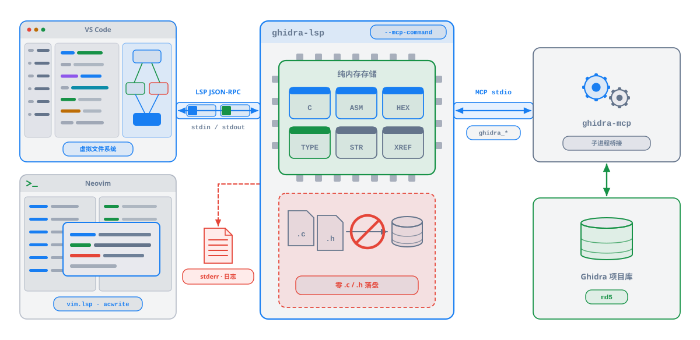
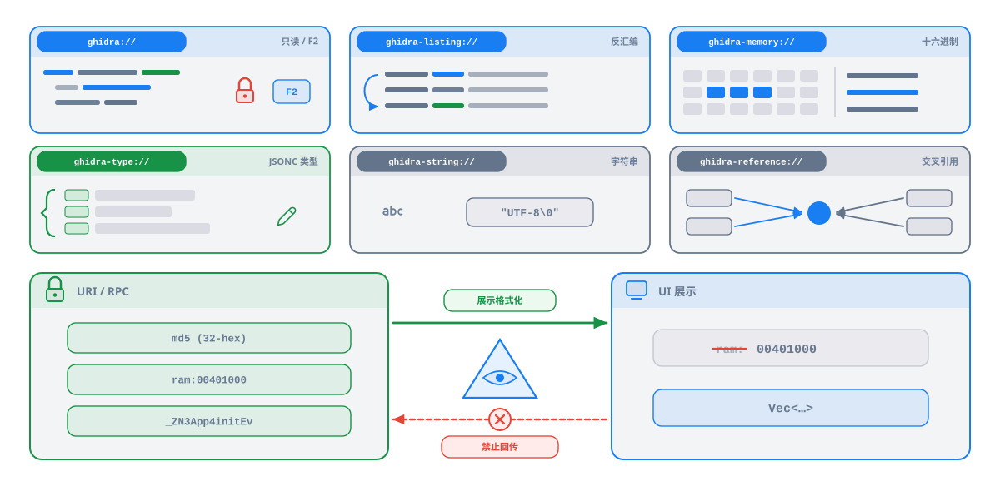
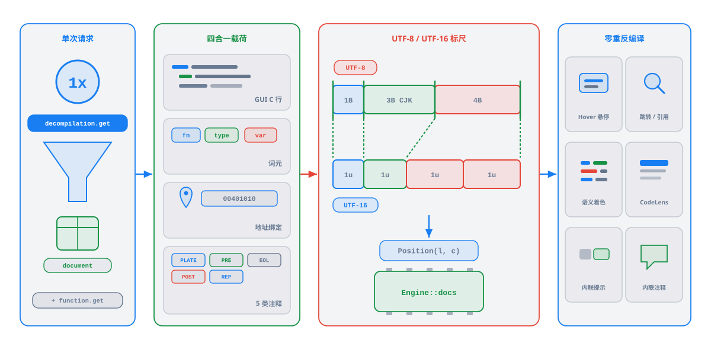

# 系统架构与核心不变量

`ghidra-lsp` 采用严格的进程边界与内存虚拟文档模型，确保反编译代码分析的高保真同步，同时避免磁盘临时文件污染或并发修改损坏 Ghidra 项目。

---

## 进程模型与通信边界

`ghidra-lsp` 遵循以下隔离规则：

1. **仓库独立性**：本仓库不与 `ghidra-mcp` 建立 Cargo path、git 或 workspace 依赖关系。`ghidra-lsp` 仅在运行时作为父进程派生 `ghidra-mcp` 子进程。
2. **双通道流严格分离**：
   - **LSP 通道**：所有 Language Server Protocol JSON-RPC 帧消息仅写入 `stdout`，从 `stdin` 读取请求。
   - **日志通道**：所有日志仅输出到 `stderr`；`ghidra-mcp` 子进程继承 `stderr`，并启用 `kill_on_drop(true)` 随服务器退出而终止。
   - **MCP 通道**：`McpBackend`（`src/backend.rs`）以懒加载方式通过 `rmcp` 的 `TokioChildProcess` 建立标准输入输出通道，调用 `ghidra_<domain>` 工具并传入 `{"operation": ..., "params": ..., "md5": ...}`。
3. **零磁盘落盘策略**：所有反编译函数、汇编清单、内存字节、字符串、交叉引用快照和数据类型文档仅存在于内存虚拟文件系统或编辑器缓冲区中，服务器从不向磁盘写入任何 `.c` 或 `.h` 文件。

---

## 6 种虚拟 URI 方案与规范标识

工作台通过 6 种规范 URI 方案隔离不同维度的分析资源：

| URI 方案 | 典型路径形态 | 读写属性 | 维护位置与用途 |
| --- | --- | --- | --- |
| `ghidra://` | `ghidra://<md5>/function/<entry>`、`ghidra://<md5>/symbol/<id>`、`ghidra://<md5>/references/<id>`、`ghidra://<md5>/type/<name-or-path>` | 反编译 C 仅允许 `<F2>` 作用域重命名预览；其余快照只读 | 由服务端 `Engine::docs` 管理，提供完整 LSP 语言服务与只读辅助视图 |
| `ghidra-listing://` | `ghidra-listing://<md5>/listing/<target>.ghidra-listing?...`（VS Code）、`ghidra-listing://<md5>/<addr>`（Neovim） | 只读 | 分页加载程序汇编指令与定义数据单元窗口，自动折叠连续未定义字节区间（`>= 8` 字节） |
| `ghidra-memory://` | `ghidra-memory://<md5>/memory/<target>.ghidra-bytes?...`（VS Code）、`ghidra-memory://<md5>/<addr>`（Neovim） | 只读 | 按块分页读取十六进制字节窗口，联动实时数据检视器（整数、IEEE-754 浮点、指针、字符串解码） |
| `ghidra-type://` | `ghidra-type://<md5>/<path>.ghidra-type?v=3`（VS Code）、`ghidra-type://<md5><path>.ghidra-type`（Neovim） | 可编辑（内置/复杂类型只读） | `.ghidra-type` JSONC 虚拟文档，支持实时语法/结构校验与图形化表单双向绑定 |
| `ghidra-string://` | `ghidra-string://<md5>/string/<display-addr>?{"address":...}` | 只读 | 以纯文本精确呈现在 Ghidra 中已定义的字符串内容，方便检索与复制 |
| `ghidra-reference://` | `ghidra-reference://<md5>/...?{"source":...}` | 只读 | 为跨函数与汇编行交叉引用提供人类可读的预览标题与位置映射，激活时跳转至真实 `ghidra://` 或 `ghidra-listing://` 目标 |

VS Code 扩展使用专用后缀（`editors/vscode/src/virtual-files.ts` 中定义的 `.ghidra-listing`、`.ghidra-bytes` 与 `.ghidra-type`），使编辑器的“Set Default Editor”文件关联严格限定在 Ghidra 标签页，而不会误匹配 `*.h` 或 `*`。

### 规范标识不变量与显示分离

`ghidra-lsp` 将**内部协议标识**与**界面展示文本**严格解耦：

- **协议层恒定不变**：
  - `md5`：始终规范化为 32 位小写十六进制字符串（例如 `scoped_md5` 与 `canonical_virtual_uri` 校验）。
  - 地址：保持规范 `space:offset` 形式（例如 `ram:00401000`、`EXTERNAL:00000010`）。
  - 符号 ID 与原始修饰名（Mangled Name）：在 `Engine`、URI 编码与后端 RPC 参数中原样流转，不作截断。
- **展示层按需格式化**：
  - `display_address`（`src/address.rs`）仅在界面展示时剥离默认 `ram:` 前缀以裸十六进制呈现，其它地址空间保留完整 `space:offset`。
  - `brief_templates`（`src/document.rs`）根据配置 `templateArguments`（`"omit"` 或 `"show"`）仅在显示标签与悬停标题中将外层 C++ 模板参数折叠为 `<…>`，同时显式保留 `operator<<`、`operator->` 等运算符以及 `<EXTERNAL>` 等命名空间；完整的反修饰名（Demangled Name）与原始修饰名始终保留在悬停与工具提示中。

---

## UTF-16 坐标、UTF-8 切片与 `u64` 安全地址运算

1. **LSP UTF-16 与 Rust UTF-8 双向精确转换**：
   - 服务器在 `initialize` 阶段协商 `PositionEncodingKind::UTF16`。
   - `src/document.rs` 中的 `position()` 与 `offset()` 将 `Document::base` 中的 UTF-8 字节偏移精确映射为行号与 UTF-16 码元列号。
   - 在切片任意字符串或计算补全前缀与行范围时，始终通过 `is_char_boundary` 确保只在合法 UTF-8 字符边界处切片，避免中文注释、宽字符或字符串字面量触发字节越界崩溃。
2. **带溢出检查的 64 位地址算术**：
   - `src/address.rs` 中的 `parse_address` 会显式拒绝 `stack:`、`register:`、`const:`、`unique:`、`variable:`、`hash:` 等非内存地址空间以及带下标后缀的伪地址。
   - `add_address_offset` 使用 `i128::checked_add` 与 `[0, u64::MAX]` 区间检查执行偏移加减；`compare_addresses`、`clamp_address` 与 `align_row_address` 均先在同地址空间内校验后再运算，防止 64 位地址上溢或下溢回绕。

---

## 单次反编译请求预算与批处理管线

为消除频繁往返导致的反编译延迟与状态撕裂，`Engine::generate_inner`（`src/engine/mod.rs`）强制执行**单次反编译请求预算**：

1. **单次 `decompilation.get` 抓取**：
   - 请求参数固定为 `{"selector": {"entry": entry}, "scan": {"timeout_ms": 30000}, "format": "document", "include_comments": true}`。
   - 一次返回即包含：反编译 C 文本（`c`）、规范入口（`entry`）、原生 GUI 逐行布局与 Token UTF-16 起止列（`lines`）、每个 Token 绑定的指令/代码单元地址（`location_address`、`code_unit_address`、`max_address`）及内置符号元数据，以及补充的可重复注释列表（`comments`、`comments_complete`）。
   - 仅当连接到不兼容 `format: "document"` 的旧版 `ghidra-mcp` 时，才回退至 `format: "text"` 与 `format: "tokens"` 并行附带降级告警诊断。
2. **原生布局校验与 5 类注释合流**：
   - `gui::spans`（`src/gui.rs`）逐行比对缩进、Token 起止列和字符串拼接，验证 `lines` 与 `c` 逐字节一致。
   - `comments::include`（`src/comments.rs`）将返回的 `repeatable` 补充注释按锚点地址精确插入虚拟 C 缓冲区的函数体或对应指令行，并自动平移后续所有 `Span` 的字节偏移。此时单份内存文档已承载 `PLATE`、`PRE`、`EOL`、`POST`、`REPEATABLE` 全部 5 类注释上下文。
3. **批处理与有界分页查询**：
   - 汇编清单的批量交叉引用查询使用 `ghidra_batch`（单波最多 `MAX_XREF_BATCH = 64` 个地址）；视图与图查询使用 `batch.execute`（只读批处理采用 `transaction_mode: "per_item"`）或上限为 `page.limit = 1000` 的游标分页 `list_all`，并内置游标去重防环检查。
   - 内存缓存由 `ViewCache`（`ProgramMetaCache`，`src/views/mod.rs`）与 `Engine` 共用：当任何变更提交至 Ghidra 后，服务器立即调用 `self.view_cache.invalidate(md5)` 清除元数据与调用图缓存，刷新所有受影响的 `ghidra://` 文档并广播 `ghidra/changed` 通知。

下一章：[Visual Studio Code 使用指南](vscode-guide.md) 或 [Neovim 插件使用指南](neovim-guide.md)。
