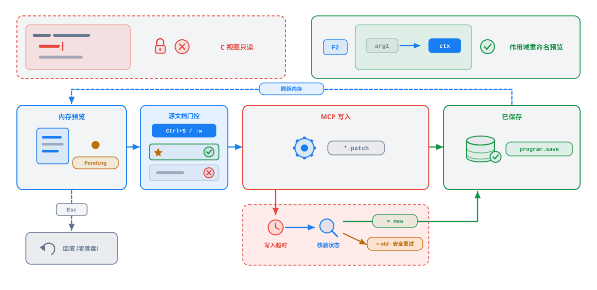
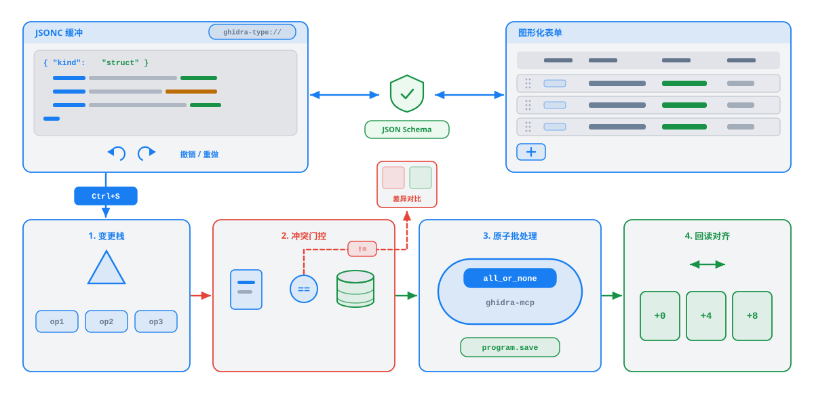

# 受控编辑与数据安全模型

`ghidra-lsp` 将“反编译文本只读”与“受控持久化”作为核心安全准则：任何自由文本编辑都不会直接改写 Ghidra 数据库；所有变更都必须经过严格校验、作用域约束与持久化确认，并在写超时后先读取后端真实状态。

---

## 只读伪代码保障与作用域 `<F2>` 重命名生命周期

1. **禁止任意文本写入**：
   - `ghidra://` 反编译 C 文档在服务端的 `Engine::save` 与 `ghidra.saveDocument` 入口处强制拒绝任意文本改动（返回 `"Only an F2 rename can be saved to Ghidra; arbitrary text edits are not supported"`）。
   - Neovim 的 `client.lua` 同时安装 `WorkspaceEdit` 拦截包装器并配置缓冲区只读守卫，VS Code 端则通过 `readonlyDocuments: true` 与只读 `FileSystemProvider` 双重约束。
2. **作用域预览计划（不写后端）**：
   - 用户按下 `<F2>`（或运行重命名命令）触发 `textDocument/prepareRename` 与 `textDocument/rename`。
   - `Engine::rename`（`src/engine/rename.rs`）验证新名称为有效 ASCII C 标识符（`[A-Za-z_][A-Za-z0-9_]*`）、与原名不同且不与同函数内其他参数/局部变量冲突。
   - 若为函数局部符号（`Local` / `Parameter`），替换范围仅限于当前函数文档；若为全局符号/函数，则跨同一 `md5` 会话下所有已打开的干净虚拟文档规划 `WorkspaceEdit`，并将期望文本记录在 `Pending { origin, symbol, new_name, expected, patched: false }` 中。此时**不发送任何 MCP 写请求**。
3. **Origin Save 提交与生命周期管理**：
   - 当且仅当用户保存发起重命名的原始（Origin）文档（VS Code 按 `Ctrl+S`/`Cmd+S`，Neovim 在源缓冲区执行 `:w`）时，`Engine::save` 才核对所有受影响文档均无杂项改动。
   - 关闭标签页或编辑器窗口**不会**触发保存；在预览完成前尝试开始重新分析、关闭会话或执行其他变更会被 `ensure_program_clean` 拒绝；可随时执行 `ghidra.discardRename` / `:GhidraDiscardRename` 放弃预览并回滚。

---

## 写超时防护与幂等恢复机制

在分布式或高负载 Ghidra 后端场景下，写操作可能在后端成功生效后才在客户端超时。`ghidra-lsp` 通过三道防线防止重复提交或覆盖状态：

1. **写前标记 `patched` 标志**：`Engine::save` 在调用后端 `patch` 前即置位 `pending.patched = true`。若遇普通验证错误则清零允许修正；若捕获超时错误（消息包含 `timed out`），则保留 `patched = true`。
2. **传输层读写区分（`src/backend.rs`）**：`McpBackend::call` 将只读查询与写操作（及 `batch`）显式区分；写操作一旦超时，立即销毁旧子进程会话并返回明确提示：`"MCP <domain>.<operation> timed out; a write may have completed. Refresh before retrying."`。
3. **重读后端状态后再重试**：在重新触发保存前，`resolve_rename_target` 会重新查询符号/函数真实名称；若发现后端已变为 `new_name`，则跳过重复 `patch` 并直接执行 `program.save` 持久化与文档刷新。同理，所有注释、原型与类型编辑器在收到不确定保存错误（`POST_SEND_WARNING` / `uncertain`）后会锁定提交按钮，要求先刷新或对比再继续。

---

## 5 类行内注释与原子函数/变量变更

### 5 类注释并发安全编辑

`src/mutations/mod.rs` 支持 Ghidra 全部 5 种代码单元注释类别：`plate`、`pre`、`eol`、`post`、`repeatable`。VS Code 行内注释线程顶部的 **Comment type** 横向徽章页签栏（`ghidraLsp.selectCommentKind`）与 Neovim 注释浮窗页脚均按固定顺序展示 `PLATE`、`PRE`、`EOL`、`POST`、`REPEATABLE (ext)` 5 个页签以切换当前编辑区（在 VS Code 中选中 `repeatable` 时，下方单个编辑框标题栏显示作者 `REPEATABLE` 与状态 `extension`，因反编译视图中的可重复注释由 `decompilation.get` 补充注入）：

- 读取使用 `ghidra.commentsAt` 按指定地址分页拉取 5 类注释文本。
- 保存使用 `ghidra.saveComment`，通过 `expected` 参数实施乐观并发控制：若 Ghidra 中的现有注释与打开编辑框时的 `expected` 不一致，拒绝写入并报错 `"This comment changed outside the editor. Close and reopen the comments before saving."`。
- 当提交文本去除空白后为空字符串时，自动转换为 `comment.delete` 操作移除对应注释。

### 函数原型与局部变量的 `all_or_none` 事务

通过 `ghidra.functionPrototype`、`ghidra.saveFunctionPrototype` 与 `ghidra.saveVariables` 修改函数名、返回类型、调用约定、可变参数标志（`hasVarArgs`）、`noreturn`、`inline`、函数注释以及参数/局部变量的类型与名称时：

- 提交载荷必须附带打开表单时捕获的 `original` 函数快照；提交前服务端先拉取最新 `function.get` 比对，若分析已在外部变化则拦截（`CONFLICT_FORM`）。
- 所有底层修改操作编译为单一 `batch.execute` 请求，强制设置 `"transaction_mode": "all_or_none"`；`workbench::check_write_result` 检查每项结果，若任一项出错则整批回滚（`Ghidra rejected the atomic batch; no changes were saved`）。
- 直接调用 `ghidra.mutate` 工作台命令同样必须通过 `WRITE` 白名单校验，批量写入限制 `1` 至 `1000` 项，且禁止在批处理项内夹带 `program.save`；每次写操作完成后统一由 `Server::commit_and_refresh` 调用 `program.save` 并验证返回 `"saved": true`。

---

## `.ghidra-type` JSONC 事务与模式校验

`ghidra-type://` 虚拟文件与 VS Code **Ghidra Data Type Editor** 基于统一的 JSONC 解析器（`src/types_doc/jsonc.rs`）、模型校验器（`src/types_doc/parse.rs`）以及 `editors/vscode/schemas/data-type.schema.json`：

### 支持编辑的类型与 JSONC 约束

所有编辑对象顶层只允许包含只读标识字段 `path`、`kind`（修改这两项会被校验器拦截）以及以下与 `kind` 对应的成员字段（虚拟 JSONC 文档正文中不嵌入 `$schema` 字段，模式校验由扩展配置和 `ghidra.validateTypeDocument` 在外部绑定）：

| `kind` | 成员键 | 校验规则与约束（来自 `data-type.schema.json` 与 `parse.rs`） |
| --- | --- | --- |
| `struct` | `fields` | 数组元素允许键：`id`（可选，保留已有成员唯一 ID 以便重命名，新增成员省略）、`offset`（必填，`0` 到 `2147483647` 整数且不可重复）、`name`、`type`（非空类型引用，如 `int`、`/types/Record`、`char *`、`int[4]`）、`length`（可选正整数 `1` 到 `2147483647`）。 |
| `union` | `fields` | 禁止出现 `offset` 属性；成员 `name` 必须非空且在联合体内唯一；其余支持 `id`、`type`、`length`。 |
| `enum` | `values` | 数组元素允许键：`id`（可选）、`name`（非空且唯一）、`value`（必须在 IEEE-754 无损 JSON 安全整数范围 `-9007199254740991` 到 `9007199254740991` 之间）。 |
| `function` | `signature` | 对象允许键：`return_type`、`calling_convention`（非空且不能为 `"unknown"`，默认 `"default"`）、`has_var_args`（布尔值）、`has_no_return`（布尔值）、`parameters`（`{name, type}` 数组）。 |

### 只读保护与并发冲突处理

- **自动降级只读的类型**：内置基元类型、`typedef`、零长度或重叠结构体字段、位域（名称带 `:位宽` 后缀）、包含多个匿名字段的结构体或任意匿名成员的联合体、缺少结构化签名的函数定义以及值超出 53 位无损 JSON 安全整数范围的 64 位枚举，均以只读模式打开并附带明确原因注释。
- **保存流水线与草稿保护**：保存前 `fetch_and_check_type_conflict` 使用 `same_type_data` 比对当前 Ghidra 后端快照与本地 `original` 快照。若外部已更改，编辑器保留用户当前草稿不丢弃，并引导通过 **Compare Data Type with Ghidra** 与 **Reload Data Type from Ghidra** 审阅差异后再提交。写成功并持久化后，服务端重新读取规范化后的类型结构（含 Ghidra 自动调整后的对齐偏移量与新分配的成员 `id`）回写至编辑缓冲区。

---

## 项目检查点与干净会话重置

在提交任何符号重命名（`Engine::save`）、注释更新（`ghidra.saveComment`）、函数签名或变量编辑（`ghidra.saveFunctionPrototype`、`ghidra.saveVariables`）、JSONC 数据类型写入（`ghidra.saveTypeDocument`）、重新分析（`ghidra.beginReanalyze`、`ghidra.reanalyze`）以及工作台修改（除 `program.save` 外的 `ghidra.mutate`）之前，`ghidra-lsp` 会自动调用 `ghidra-mcp` 的 `session.checkpoint.create` 记录修改前快照（`src/engine/checkpoints.rs`）。

`ghidra-mcp` 先执行 `program.save` 持久化当前活动程序，再将 `project.gpr` 与 `project.rep/` 复制到 `projects/<md5>/checkpoints/<id>/`（自动跳过瞬态 `.lock` / `.lock~` 锁文件），并在超出 `[checkpoints] max_per_binary` 上限时淘汰最早的检查点。

- **恢复检查点（`ghidra.restoreCheckpoint`）**：以不保存方式强制停止当前 Ghidra 进程（`force = true`），从所选检查点（省略 `id` 与 `name` 时取最新检查点）原子替换 `projects/<md5>/ghidra/` 并重新启动会话，清理待决重命名，重新生成全部已打开的 `ghidra://` 反编译与快照缓冲区、同步 `ghidra-type://` 文档并广播 `ghidra/changed` 刷新所有侧边栏与分析视图。
- **重置会话（`ghidra.resetSession`）**：不保存即停止活动 Ghidra 进程，删除 `projects/<md5>/ghidra/` 与 `projects/<md5>/checkpoints/`，同时完整保留 `binary` 与 `binary.json`，按需重新导入并执行自动分析（`reopen: true`、`analyze`），再刷新全部已打开视图。

下一章：[LSP 能力参考与开发规范](lsp-and-development.md)。
