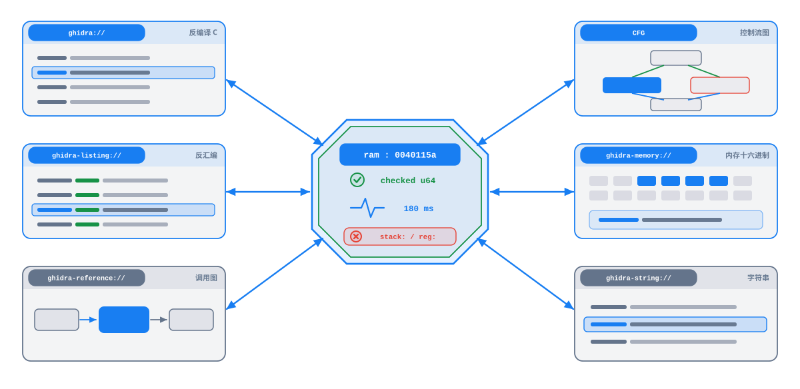

# Neovim 插件使用指南

`editors/nvim/` 提供了原生 Neovim 插件（要求 Neovim `>= 0.10`），将 `ghidra-lsp` 的全部 LSP 能力与逆向工程视图（汇编清单、十六进制内存与数据检视器、控制流图、调用图、字符串列表、5 类注释浮窗、函数签名/变量表单与 `.ghidra-type` JSONC 缓冲区）原生集成到分屏与浮窗工作流中。

---

## 安装与配置

当 `server_path` 与 `mcp_command` 保持默认且未在 `PATH` 中找到时，插件会自动通过 `npm` 安装 `@ghidra-lsp/cli` 与 `@ghidra-mcp/cli` 到共享托管目录（Linux/macOS 为 `~/.local/share/ghidra-lsp/bin`，Windows 为 `%LOCALAPPDATA%\ghidra-lsp\bin`，与 VS Code 扩展复用同一份二进制）。随时可执行 `:GhidraInstall` 手动安装或更新。

### 使用 `lazy.nvim` 安装

```lua
{
    'ghidra-lsp',
    dir = '/path/to/ghidra-lsp/editors/nvim',
    config = function()
        require('ghidra-lsp').setup({
            server_path = 'ghidra-lsp',
            mcp_command = 'ghidra-mcp',
            mcp_args = {},
            request_timeout_ms = 35000,
            template_arguments = 'omit',
            auto_attach = true,
        })
    end,
}
```

### 使用 `packer.nvim` 安装

```lua
use({
    '/path/to/ghidra-lsp/editors/nvim',
    config = function()
        require('ghidra-lsp').setup({
            server_path = 'ghidra-lsp',
            mcp_command = 'ghidra-mcp',
            mcp_args = {},
            request_timeout_ms = 35000,
            template_arguments = 'omit',
            auto_attach = true,
        })
    end,
})
```

### 使用 `vim.pack`（Neovim `0.12+`）

由于 Neovim 插件位于仓库的 `editors/nvim` 子目录中，可在调用 `setup` 前通过 `vim.pack.add` 注册仓库并将 `editors/nvim` 加入 `runtimepath`：

```lua
vim.pack.add({
    'https://github.com/ByteLandTechnology/ghidra-lsp',
})
vim.opt.runtimepath:append(vim.fn.stdpath('data') .. '/site/pack/core/opt/ghidra-lsp/editors/nvim')
require('ghidra-lsp').setup({
    server_path = 'ghidra-lsp',
    mcp_command = 'ghidra-mcp',
    template_arguments = 'omit',
})
```

### 可用配置项（`editors/nvim/lua/ghidra-lsp/client.lua`）

| 选项 | 默认值 | 说明 |
| --- | --- | --- |
| `server_path` | `'ghidra-lsp'` | `ghidra-lsp` 可执行文件名称或绝对路径。 |
| `mcp_command` | `nil` | 传递给 `--mcp-command` 与 `initializationOptions.mcpCommand` 的路径；为 `nil` 时由服务端使用默认值 `ghidra-mcp`。 |
| `mcp_args` | `{}` | 传给 `ghidra-mcp` 子进程的参数数组。 |
| `request_timeout_ms` | `35000` | 单次后端 MCP 请求超时毫秒数。 |
| `template_arguments` | `'omit'` | `'omit'` 折叠外层 C++ 模板参数为 `<…>`；`'show'` 完整展示。 |
| `auto_attach` | `true` | 打开 `ghidra://` 等受支持虚拟缓冲区时自动附着 LSP 客户端。 |
| `auto_start` | `false` | 设为 `true` 时在调用 `setup()` 阶段立即启动语言服务器。 |
| `auto_install` | `true` | 设为 `true` 时在默认二进制缺失时自动通过 `npm` 安装到共享托管目录。 |

### 健康检查

安装完成后运行以下命令自检：

```text
:checkhealth ghidra-lsp
```

检查项（`editors/nvim/lua/ghidra-lsp/health.lua`）涵盖 Neovim `>= 0.10` 版本、`npm` 可用性、共享托管二进制目录、`server_path` 与 `mcp_command` 解析来源（`managed`/`path`/`custom`）与可执行性、活跃 LSP 客户端的 `offset_encoding`（期望为 `utf-16`），以及当前选中的 Ghidra 会话与待决重命名状态。

---

## 工作台全景


---

## 32 条用户命令参考（`editors/nvim/plugin/ghidra-lsp.lua`）

### 会话与二进制管理

| 命令 | 参数 | 功能说明 |
| --- | --- | --- |
| `:GhidraInstall` | `[lsp\|mcp]` | 通过 `npm` 安装或更新托管目录中的 `ghidra-lsp` 与 `ghidra-mcp` 二进制文件。 |
| `:GhidraOpenBinary` | `[path\|md5] [options...]` | 打开二进制、固件镜像、`.gpr` 项目或已保存 MD5（支持 `programName=`、`processor=`、`compilerSpec=`、`loader=`、`baseAddress=`、`reimport=` 参数补全）。 |
| `:GhidraSelectSession` | `[md5]` | 列出并切换到活跃或历史保存的 Ghidra 会话。 |
| `:GhidraCloseSession` | `[md5]` | 关闭当前或指定会话（若存在未保存的待决重命名会阻止关闭）。 |
| `:GhidraCheckpoints` | `[md5]` | 打开检查点选择器浏览并恢复项目检查点。 |
| `:GhidraRestoreCheckpoint` | `[id\|name]` | 恢复最新检查点或通过 `<Tab>` 补全选定的检查点并刷新全部缓冲区。 |
| `:GhidraResetSession` | `[analyze\|noanalyze]` | 将当前会话重置为干净的重新导入状态（可选自动分析）并刷新全部缓冲区。 |
| `:GhidraReanalyze` | — | 对当前激活程序触发重新分析。 |
| `:GhidraOverview` | — | 打开程序概览只读快照窗口（`ghidra-overview://<md5>`）。 |

### 符号浏览与跳转

| 命令 | 参数 | 功能说明 |
| --- | --- | --- |
| `:GhidraOpenFunction` | `[entry\|name]` | 按入口地址或函数名打开反编译缓冲区，支持 `<Tab>` 动态补全。 |
| `:GhidraFunctions` | — | 弹出可搜索过滤的函数选择器并打开对应 `ghidra://` 缓冲区。 |
| `:GhidraSymbols` | — | 浏览程序全部全局符号并跳转。 |
| `:GhidraTypes` | — | 浏览数据类型目录。 |
| `:GhidraStrings` | — | 浏览已定义字符串（支持跳转到引用位置与 Quickfix 格式显示）。 |
| `:GhidraGoto` | `[address]` | 跳转至指定地址：优先定位到反编译伪代码，若在函数外则回退到汇编清单。 |
| `:GhidraCallHierarchy` | — | 在光标处打开 LSP 调用层次树。 |

### 逆向分析专用视图

| 命令 | 参数 | 功能说明 |
| --- | --- | --- |
| `:GhidraListing` | `[address]` | 在分屏打开 Program Listing（`ghidra-listing://`），支持指令折叠与分页。 |
| `:GhidraMemory` | `[address]` | 在分屏打开十六进制内存与实时 Data Inspector（`ghidra-memory://`）。 |
| `:GhidraHex` | `[address]` | `:GhidraMemory` 的命令别名。 |
| `:GhidraControlFlow` | — | 打开当前函数的基本块控制流图缓冲区（`ghidra-cfg://`）。 |
| `:GhidraCallGraph` | `[entry\|address]` | 打开有界调用图缓冲区（`ghidra-callgraph://`），支持 `callers`/`callees` 双向展示与交互调整深度。 |

### 受控编辑与草稿控制

| 命令 | 参数 | 功能说明 |
| --- | --- | --- |
| `:GhidraComment` | `[address]` | 打开 5 类行内注释浮动编辑器（未传地址时取光标所在代码单元）。 |
| `:GhidraEditFunction` | — | 打开当前函数签名、调用约定、属性（`varargs`/`noreturn`/`inline`）及参数浮动编辑表单。 |
| `:GhidraEditVariables` | — | 选择参数或局部变量，交互修改名称与数据类型后原子提交。 |
| `:GhidraEditType` | `[path]` | 打开可编辑的 `ghidra-type://<md5><path>.ghidra-type` JSONC 缓冲区（内置/复杂类型只读）。 |
| `:GhidraAssemble` | `[address]` | 在光标处或指定地址汇编写入 Sleigh 指令。 |
| `:GhidraDisassemble` | `[address\|start..end]` | 对光标处、可视范围或指定地址的未定义字节执行反汇编。 |
| `:GhidraClear` | `[address\|start..end]` | 清除（Undefine）光标处、可视范围或指定地址的代码单元定义。 |
| `:GhidraPatchBytes` | `[address]` | 在光标处或指定地址修补十六进制字节。 |
| `:GhidraRefresh` | — | 从 Ghidra 重新抓取并刷新当前虚拟缓冲区。 |
| `:GhidraDiscardRename` | — | 放弃当前会话中所有尚未提交的 `<F2>` 重命名预览并恢复原文。 |
| `:GhidraOrigin` | — | 跳转回发起当前待决重命名的原始（Origin）反编译缓冲区以便执行 `:w`。 |

---

## 键位映射一览

### `ghidra://` 反编译与快照缓冲区（`buffer.lua`）

| 按键 | 适用缓冲区 | 行为 |
| --- | --- | --- |
| `K` | 全部 `ghidra://` | 圆角浮窗显示符号/类型悬停文档（含完整反修饰名与原始修饰名）。 |
| `<C-k>` | 全部 `ghidra://` | 显示函数参数签名帮助（Signature Help）。 |
| `gd` / `gD` / `gi` | 全部 `ghidra://` | 跳转到定义 / 声明 / 实现（函数自动打开或定位，变量跳转至声明）。 |
| `gy` | 全部 `ghidra://` | 跳转到光标下变量或表达式的类型定义（`ghidra://.../type/...`）。 |
| `gr` | 全部 `ghidra://` | 查找全程序跨函数交叉引用。 |
| `gO` | 全部 `ghidra://` | 打开当前文档符号大纲。 |
| `<F2>` / `<leader>rn` | 全部 `ghidra://` | 发起作用域重命名预览（仅在源缓冲区执行 `:w` 才提交至 Ghidra）。 |
| `<leader>ca` | 全部 `ghidra://` | 打开 Code Actions（编辑注释、修改函数签名、修改变量、检视/编辑类型或切换视图）。 |
| `<leader>gl` | 仅函数反编译缓冲区 | 在光标对应地址打开 Program Listing。 |
| `<leader>gm` | 仅函数反编译缓冲区 | 在光标对应地址打开 Hex / Memory 视图。 |
| `<leader>gc` | 仅函数反编译缓冲区 | 在光标对应代码单元打开 5 类行内注释浮窗。 |
| `<leader>go` | 仅函数反编译缓冲区 | 提示输入地址并执行跳转。 |
| `<leader>gh` | 仅函数反编译缓冲区 | 显示当前函数的调用层次结构。 |
| `<leader>gt` | 全部 `ghidra://` | 为光标处类型（或选择器选中的类型）打开 `.ghidra-type` JSONC 缓冲区。 |
| `q` | 仅非函数快照缓冲区 | 关闭当前只读快照分屏窗口（需保留至少一个其余窗口）。 |

### 专用分析分屏视图按键



| 视图缓冲区 | 导航与同步按键 | 翻页 / 控制按键 |
| --- | --- | --- |
| `ghidra-listing://`（汇编清单） | `<CR>` 或 `d` 反编译定位；`m` 打开 Memory；`c` 编辑注释；`a` 汇编指令；`D` 反汇编；`u` 清除定义；`p` 修补字节；`gr` 或 `x` 查交叉引用；`g` 跳转地址 | `]p` / `[p` 向前向后翻页；`]b` / `[b` 切换上下内存块；`r` 刷新；`q` 关闭 |
| `ghidra-memory://`（内存十六进制） | `<CR>` 或 `l` 打开 Listing；`d` 反编译定位；`a` 汇编指令；`D` 反汇编；`u` 清除定义；`p` 修补字节；`g` 跳转地址（移动光标即更新顶部两行实时 Data Inspector） | `e` 切换大小端序（`little`/`big`）；`]p` / `[p` 翻页；`r` 刷新；`q` 关闭 |
| `ghidra-cfg://`（控制流图） | `<CR>` 在反编译中揭示当前基本块；`l` 在 Listing 中打开 | `r` 刷新；`q` 关闭 |
| `ghidra-callgraph://`（调用图） | `<CR>` 打开光标所在函数；`l` 在 Listing 中打开 | `+` / `-` 增减上下游遍历深度（`1` 到 `3`）；`r` 刷新；`q` 关闭 |
| `ghidra-string://`（字符串预览） | `gr` / `x` 将传入交叉引用加载到 Quickfix；`<leader>gl` 打开 Listing；`<leader>gm` 打开 Memory | `q` 关闭 |

---

## 浮动编辑器、主题高亮组与 JSONC 类型编辑工作流

### 主题联动高亮组（`ui.lua`、`init.lua`）

调用 `setup()` 时，`ui.setup_highlights()` 会以 `default = true` 注册以下可随配色方案覆盖的高亮组，并通过 `GhidraLspHighlights` 自动命令组在 `ColorScheme` 切换时自动重新应用：

| 高亮组 | 默认链接目标 | 用途 |
| --- | --- | --- |
| `GhidraFloatBorder` | `FloatBorder` | 浮窗边框样式 |
| `GhidraFloatTitle` | `Title` | 浮窗顶部标题文字 |
| `GhidraFloatFooter` | `Comment` | 浮窗底部按键提示与未选中空分类徽标 |
| `GhidraTabActive` | `PmenuSel` | 当前激活的注释分类徽标 |
| `GhidraTabDirty` | `DiagnosticWarn` | 未保存修改标记（`*` 与 `[*]`）及警告状态提示 |
| `GhidraTabFilled` | `DiagnosticInfo` | 包含非空内容的非当前分类徽标与 `saved` 状态提示 |
| `GhidraStatusAccent` | `Special` | 分隔符 `│` 与底部操作键位高亮 |

上述高亮组通过 `ui.FLOAT_WINHIGHLIGHT` 统一应用到注释浮窗、函数签名浮窗以及 `ui.pick` 模糊搜索选择器浮窗，并基于版本探测（`nvim-0.9` 标题、`nvim-0.10` 页脚）安全渲染分块高亮边框文本。

### 5 类行内注释浮窗（`ghidra-comment://`）

在函数反编译、汇编清单或内存视图光标处按下 `<leader>gc`（或清单中按 `c`）或运行 `:GhidraComment` 后，会打开高度自适应的圆角浮窗：

- **顶部标题与底部徽标栏**：顶部边框显示 `Ghidra Comments · <address>`、当前分类徽标（如 `[PRE]` / `[PRE*]`）与保存状态；底部页脚按固定顺序渲染全部 5 类徽标 `[PLATE] [PRE] [EOL] [POST] [REPEATABLE (ext)]`（活动标签使用 `GhidraTabActive`、未保存草稿 `*` 使用 `GhidraTabDirty`、已有内容使用 `GhidraTabFilled`），后接 `│ :w/<C-s> save · <Tab> kind · q close`。
- **标签页切换与原生 `d` 保留**：使用 `<Tab>` 与 `<S-Tab>` 在 5 种注释间轮换。缓冲区保留普通模式下 Vim 原生 `d` 操作符（`dd`、`dw`、`d$` 均可正常编辑文本，未映射为删除整条注释快捷键）。
- **保存与删除**：在普通或插入模式下按 `<C-s>`，或在普通模式下执行 `:w`，即通过 `ghidra.saveComment` 携带乐观锁基准 `expected` 提交到 Ghidra；将某一类别的缓冲区文本清空（全空白）后保存即删除该类注释。
- **安全关闭**：按 `q` 或 `<Esc>` 关闭；若有未保存草稿会弹出确认框避免误丢内容。若发生写超时不确定状态（`uncertain`），浮窗会禁止盲目重复提交并提示重新打开核对。

### 函数签名表单与 `.ghidra-type` 缓冲区

- **函数签名表单（`ghidra-edit-fn://`）**：浮窗顶部展示 `Edit Function · <name> [<address>]`（含未保存 `[*]` 指示），底部展示 `:w save to Ghidra │ q close`；正文以类 YAML 键值对呈现 `name`、`return_type`、`calling_convention`、`varargs`、`noreturn`、`inline`、`comment` 与 `param.N: <type> | <name>` 行，编辑后执行 `:w` 即触发 `all_or_none` 批量提交，按 `q` 关闭。
- **`.ghidra-type` 缓冲区（`ghidra-type://<md5><path>.ghidra-type`）**：在 `TextChanged` 与 `InsertLeave` 事件自动调用 `ghidra.validateTypeDocument` 实时发布精确到 UTF-16 范围的 LSP 诊断；执行 `:w` 时校验并发冲突并自动回读归一化后的最新 Ghidra 布局与成员 ID。

下一章：[受控编辑与数据安全模型](editing-and-safety.md)。
