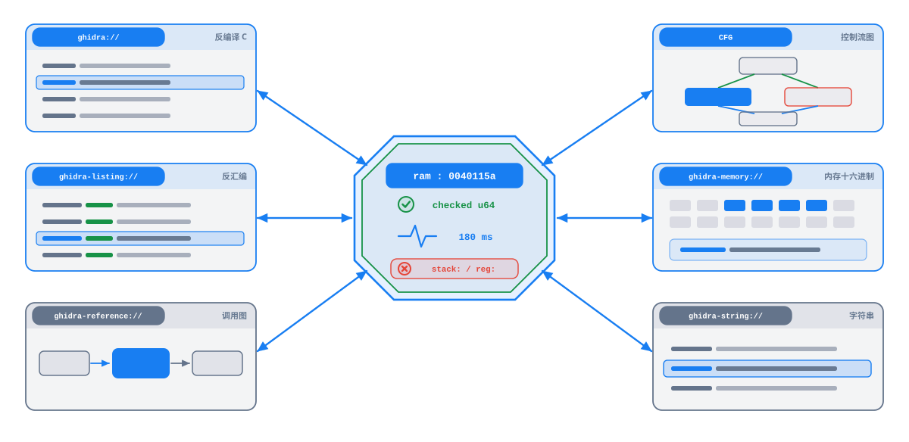
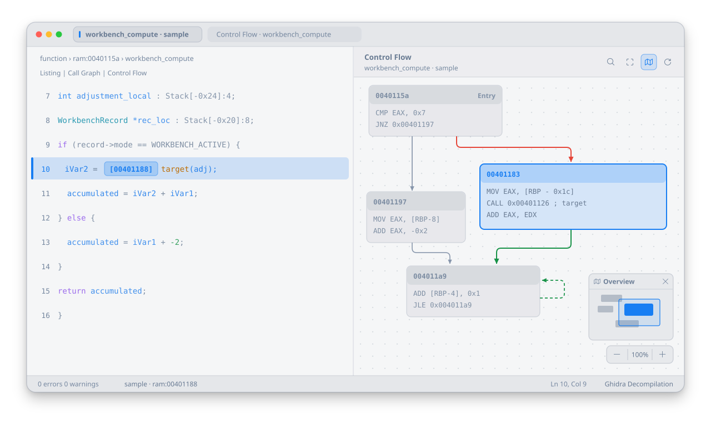
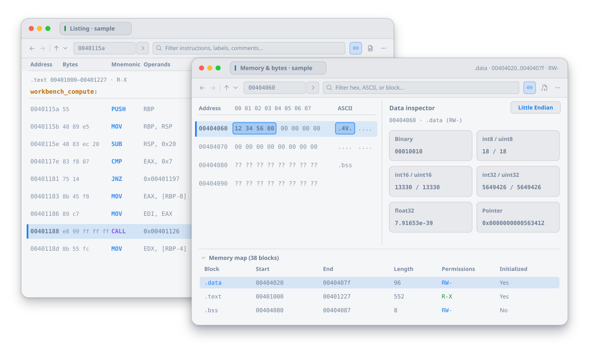

# Visual Studio Code 使用指南

`editors/vscode/` 目录提供了官方 **Ghidra LSP** 扩展（要求 VS Code `^1.96.0`，扩展 ID 为 `byteland-app.ghidra-lsp`），将反编译伪代码、控制流图、调用关系与米勒分栏、程序汇编清单、十六进制内存视图、5 类行内注释与 JSONC/图形化数据类型编辑器整合到统一工作台中。

---

## 安装与基础配置

### 本地编译与打包安装

```sh
npm --prefix editors/vscode install
npm --prefix editors/vscode run check
npm --prefix editors/vscode run package
code --install-extension editors/vscode/ghidra-lsp-<version>.vsix
```

扩展打包配置会排除父目录资源，离线打包与发布请遵循 `editors/vscode/README.md` 的说明。

### 扩展设置项（`ghidraLsp.*`）

当 `ghidraLsp.serverPath`（`"ghidra-lsp"`）和 `ghidraLsp.mcpCommand`（`"ghidra-mcp"`）保持默认值且未在 `PATH` 中找到时，扩展会自动通过 `npm` 安装 `@ghidra-lsp/cli` 与 `@ghidra-mcp/cli` 到共享托管目录（Linux/macOS 为 `~/.local/share/ghidra-lsp/bin`，Windows 为 `%LOCALAPPDATA%\ghidra-lsp\bin`）。

| 配置项 | 类型与默认值 | 说明 |
| --- | --- | --- |
| `ghidraLsp.autoInstall` | `boolean`，默认 `true` | 当使用默认可执行文件名且缺失时，自动通过 `npm` 安装 `ghidra-lsp` 与 `ghidra-mcp` 到共享用户二进制目录。 |
| `ghidraLsp.serverPath` | `string`，默认 `"ghidra-lsp"` | Rust 语言服务器可执行文件路径。修改后需重启扩展或重载窗口。 |
| `ghidraLsp.mcpCommand` | `string`，默认 `"ghidra-mcp"` | `ghidra-mcp` 后端可执行文件路径。 |
| `ghidraLsp.mcpArgs` | `string[]`，默认 `[]` | 启动 `ghidra-mcp` 子进程时追加的命令行参数列表。 |
| `ghidraLsp.requestTimeoutMs` | `number`，默认 `35000`（范围 `100`–`300000`） | 单次 MCP 后端请求的超时毫秒数。 |
| `ghidraLsp.liveRefreshIntervalMs` | `number`，默认 `2000`（最小 `0`） | 定时从 Ghidra 刷新当前可见且未修改函数视图的间隔毫秒数；设为 `0` 禁用轮询。 |
| `ghidraLsp.templateArguments` | `"omit"` \| `"show"`，默认 `"omit"` | `"omit"` 将外层 C++ 模板实参折叠为 `<…>`（完整名称与修饰名保留在悬停与提示中）；`"show"` 完整显示。 |
| `ghidraLsp.views.syncCursor` | `boolean`，默认 `true` | 是否在同一个程序的反编译视图、控制流图（`Control Flow`）、汇编清单与十六进制字节视图之间自动双向同步光标选中项。 |

推荐配合关闭自动保存，以便由人工显式确认 `F2` 重命名与数据类型提交：

```json
{
  "files.autoSave": "off",
  "files.refactoring.autoSave": false
}
```

---

## 侧边栏视图与自定义编辑器

点击活动栏中的 **Ghidra** 图标（`resources/ghidra.svg`）打开主侧边栏，包含 4 个树视图：

| 视图 ID | 名称 | 默认状态 | 功能说明 |
| --- | --- | --- | --- |
| `ghidra.sessions` | **Sessions** | 默认折叠 | 列出当前活跃会话与后台打开/分析任务，支持切换会话、查看任务进度与触发重分析或关闭。 |
| `ghidra.symbols` | **Symbols** | 默认展开 | 按 C++ 命名空间折叠分组展示函数与全局符号；未打开程序时提供 **Open Binary**、**Open Recent Program** 与 **Select an open session** 欢迎入口。 |
| `ghidra.strings` | **Strings** | 默认展开 | 浏览 Ghidra 已定义字符串；点击可在只读 `ghidra-string://` 标签页中以精确纯文本查看内容并通过 `Shift+F12` 或 CodeLens 查找交叉引用。 |
| `ghidra.types` | **Data Types** | 默认展开 | 按分类目录浏览项目数据类型，支持新建、编辑、删除与应用数据类型。 |

扩展同时注册了 2 个自定义编辑器（绑定在 `package.json` 的 `customEditors` 上，支持通过 **Ghidra: Switch Analysis View…** 在不同视图模式间切换）：

- `ghidra.analysisControlFlow`（**Ghidra Control Flow**）：绑定到 `ghidra-listing:/listing/*`，在文本清单、字节窗口与基本块控制流图间切换。
- `ghidra.dataTypeEditor`（**Ghidra Data Type Editor**）：绑定到 `ghidra-type:/**/*`，在原生 JSONC 文本视图与图形化表单编辑器之间共享同一缓冲草稿。

---

## 双向视图同步与反编译 / 控制流图联动



开启 `ghidraLsp.views.syncCursor` 后，反编译 C 缓冲区（`ghidra://`）、汇编清单（`ghidra-listing://` / 面板）、十六进制内存视图（`ghidra-memory://` / 面板）与控制流图（`ghidra.analysisControlFlow`）会共享同一地址焦点：

- **从伪代码到汇编与 CFG**：在反编译代码行移动光标时，扩展通过 `ghidra.location` 查询该 Token 对应的原生 GUI `code_unit_address`，自动高亮汇编指令与 CFG 对应基本块（带防抖与代数过滤，避免回声循环）。CFG 视图采用圆角基本块卡片（`rx="8"` / 标题栏 `rx="7"`）、入口块右对齐 `Entry` 徽标、圆角正交折线（`roundedOrthogonalPath`）以及可拖动折叠的 `Overview` 缩略图与缩放控件（`100%`）。
- **从汇编 / CFG 到伪代码**：在汇编行或 CFG 基本块中单击或双击节点时，扩展调用 `ghidra.reveal` 将对应指令映射回函数伪代码位置并定位光标。



---

## 汇编清单、十六进制内存视图与实时数据检视器

- **Program Listing**：配备紧凑型导航工具栏（历史前进/后退、窗口翻页、地址跳转输入框、行筛选与同步切换），调用 `ghidra.listingWindow` 按窗口分页获取指令与已定义数据单元（默认每窗 160 行，函数窗口上限 1000 单元，未定义字节 `>= 8` 自动折叠汇总），支持行内函数签名头、标号、交叉引用计数与 5 类注释渲染。
- **Memory & Bytes (Hex)**：调用 `ghidra.memoryWindow` 按 1024 字节块分页加载十六进制与 ASCII 对照视图（支持 8 或 16 字节行宽、大小端切换、十六进制与 ASCII 双栏选区联动及可折叠 `Memory map` 区块表）。
- **实时 Data Inspector**：右侧响应式 2 列卡片网格（`.hex-inspector`）在标题栏内嵌可点击的 **`Little Endian` / `Big Endian`** 端序切换胶囊按钮（`.hex-endian-pill`），点击即可实时按新端序重解码多字节数值，并自动调用 `ghidra.inspectBytes` 展示 `Binary`、`int8 / uint8`、16/32/64 位有符号与无符号整数、IEEE-754 浮点数、指针目标（若落在已加载内存块内可直接点击跳转）以及 UTF-8/ASCII 字符串预览。



---

## 调用图、调用者/被调用者与米勒分栏导航

- **Call Graph 顶栏与图视图**：顶栏（`.call-topbar`）提供独立的 **`Graph` / `Columns`** 分段切换按钮（`.call-view-switch`）以及函数搜索与适应画布按钮。图视图基于 `elkjs` 自动布局，受服务端有界遍历限制保护（最多 80 节点、240 条边、40 次查询），采用紧凑的 `rx="8"` 圆角节点与圆角正交折线边，并在根节点名称下方显示 `displayAddress(node.entry)` 入口地址；卡片静止时保持居中精简外观，仅在鼠标悬停或键盘聚焦时于卡片顶部（`callers`）与底部（`callees`）内沿浮现类 iOS 极简触感抓手条（悬停抓手时随展开或收起方向轻柔微弯）与右侧反编译按钮，对任意已发现节点均支持双向交互式展开或折叠（`expansion.callers` / `expansion.callees`）。
- **Call Columns（米勒分栏）视图**：顶部提供带明确文字标签的 **`Callers` / `Callees`** 方向切换按钮，多列横排展示调用路径（单路径最大深度 20 层、单列最多展示 200 个函数），在每行函数名与展开箭头之间显示调用点或入口短地址（`.call-column-addr`），自动标注递归回环节点（`cycleAt`）并允许一键反编译当前列源函数或任意行目标函数。


---

## 行内 5 类注释、作用域重命名与数据类型编辑器

- **行内注释组件**：通过 `Ctrl+.`（macOS 为 `Cmd+.`）触发快速修复 **Edit comments at …** 或运行 **Ghidra: Edit Comment**，在伪代码对应行下方展开原生 VS Code `CommentThread` 组件；顶部 **Comment type** 行提供 `PLATE`、`PRE`、`EOL`、`POST` 与 `REPEATABLE (ext)` 5 枚横向可点击徽章标签（带已填指示圆点），点击任意徽章即触发 `ghidraLsp.selectCommentKind`（Switch Comment Kind）将下方单个输入框切换至对应分类，并支持 `Edit`、`Save`、`Cancel` 与 `Close comment editor`。
- **作用域 `F2` 重命名**：在只读 `ghidra://` 文档按 `F2` 修改符号名后，编辑器会在所有受影响的已打开标签页显示 `M` 徽标与底部状态栏待保存提示；切回源标签页按 `Ctrl+S`（macOS 为 `Cmd+S`）即可提交。


- **图形化与 JSONC 类型编辑器**：打开 `ghidra-type://<md5>/<path>.ghidra-type?v=3` 时，图形化编辑器顶部显示结构化标题栏（类型徽标 `struct` / `union` / `enum` / `function` 与只读标记、规范路径、总字节数、成员数、未保存状态标记及 **`JSONC`** 并排打开按钮），支持当前聚焦行高亮、拖拽或方向键重排、表尾虚线 `+ Add field` / `+ Add value` / `+ Add parameter` 新增槽位；点击 **`JSONC`** 可在旁侧分栏（`ViewColumn.Beside`）打开同一底层文档的 JSONC 文本视图（纯模型字段，不写入 `$schema` 键，模式校验由 `package.json` 的 `jsonValidation` 绑定 `schemas/data-type.schema.json`），按下保存即执行冲突检测与事务提交。


---

## 快捷键与命令速查

### 默认快捷键

| 快捷键 | macOS | 触发上下文 | 绑定命令 |
| --- | --- | --- | --- |
| `F2` | `F2` | `resourceScheme == ghidra && editorTextFocus && !renameInputVisible` | `ghidraLsp.renameSymbol` |
| `Ctrl+S` | `Cmd+S` | `resourceScheme == ghidra && editorTextFocus && !renameInputVisible` | `ghidraLsp.saveRename` |
| `Ctrl+.` | `Cmd+.` | `resourceScheme == ghidra && editorTextFocus && editorLangId == ghidra-decompiled && !renameInputVisible` | `ghidraLsp.codeActions` |

### 完整命令列表

- **会话与生命周期**：`ghidraLsp.openBinary`（Open Binary）、`ghidraLsp.openRecent`（Open Recent Program）、`ghidraLsp.selectSession`（Select Session）、`ghidraLsp.selectSessionItem`（Switch to Session）、`ghidraLsp.openRecentItem`（Reopen Session）、`ghidraLsp.refreshSessions`（Refresh Sessions）、`ghidraLsp.closeSession`（Close Program）、`ghidraLsp.reanalyze`（Reanalyze Program）、`ghidraLsp.cancelAnalysis`（Stop Waiting for Analysis）、`ghidraLsp.programOverview`（Program Overview）、`ghidraLsp.installBinaries`（Install or Update Binaries）。
- **导航与信息检视**：`ghidraLsp.openFunction`、`ghidraLsp.goToAddress`、`ghidraLsp.demangle`、`ghidraLsp.refresh`、`ghidraLsp.refreshBrowser`、`ghidraLsp.refreshStrings`、`ghidraLsp.functionDetails`、`ghidraLsp.inspectType`、`ghidraLsp.browseSymbol`。
- **重命名、注释与代码修改**：`ghidraLsp.renameSymbol`、`ghidraLsp.saveRename`、`ghidraLsp.saveAllRenames`、`ghidraLsp.showPendingRename`、`ghidraLsp.discardRename`、`ghidraLsp.codeActions`、`ghidraLsp.editComment`、`ghidraLsp.editCommentText`（行内注释 Edit）、`ghidraLsp.selectCommentKind`（Switch Comment Kind）、`ghidraLsp.saveComment`（行内注释 Save）、`ghidraLsp.cancelCommentEdit`（行内注释 Cancel）、`ghidraLsp.closeCommentEditor`（Close comment editor）、`ghidraLsp.editFunction`、`ghidraLsp.editVariables`、`ghidraLsp.editSymbol`。
- **数据类型管理**：`ghidraLsp.createType`、`ghidraLsp.editType`、`ghidraLsp.deleteType`、`ghidraLsp.applyType`、`ghidraLsp.typeDetails`、`ghidraLsp.compareType`、`ghidraLsp.reloadType`。
- **分析窗口与图视图**：`ghidraLsp.openViews`、`ghidraLsp.analysisView`、`ghidraLsp.showListing`、`ghidraLsp.browseListing`、`ghidraLsp.showMemory`、`ghidraLsp.showStrings`、`ghidraLsp.showImports`、`ghidraLsp.showExports`、`ghidraLsp.showControlFlow`、`ghidraLsp.showCallGraph`、`ghidraLsp.showCallers`、`ghidraLsp.showCallees`、`ghidraLsp.showCallHierarchy`、`ghidraLsp.showReferences`、`ghidraLsp.showAddressReferences`；以及清单/字节工具栏专用的 `ghidraLsp.listingFunction`、`ghidraLsp.listingReferences`、`ghidraLsp.listingBytes`、`ghidraLsp.bytesListing`、`ghidraLsp.listingCopyAddress`、`ghidraLsp.listingBrowse`、`ghidraLsp.listingRefresh`。

下一章：[Neovim 插件使用指南](neovim-guide.md)。
